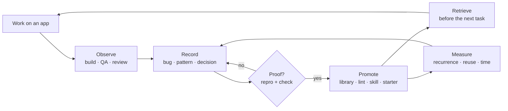

# Open-Droid backlog: issues, feature requests, and capability gaps

**This is the single consolidated backlog.** Everything the repo owner needs — what is
broken, what is missing, what shipped, what it costs to close — is on this page.

- Last verified: **2026-11-06**, Windows 11 + `Pixel_9_API_35` (API 35, 1080×1620, density 420), vendored offline toolchain; host-specific measurements are not universal guarantees
- Network: **reachable** (`dl.google.com` and `repo1.maven.org` return 200) — the cache is cold, not blocked
- Tool count: **63 MCP tools** (`test/smoke.test.mjs` is the contract)
- Test suite: **46 Node tests · 46 pass · 0 skipped** (MCP/server/scripts tests, not Android UI tests (§11.10).
- Source documents merged here: [`docs/feature-requests.md`](docs/feature-requests.md),
  [`docs/capability-matrix.md`](docs/capability-matrix.md), [`EMULATOR-CROPPING-ISSUE.md`](EMULATOR-CROPPING-ISSUE.md),
  plus defects found while building `hello-app`

**Priority and status legend**

Priority and workflow status are separate concepts. The coloured markers encode priority; the
word after the marker (or in a dedicated status field) encodes workflow state.

| Mark / value | Meaning |
|---|---|
| 🔴 P0 | Critical priority — blocks a core promise or release path |
| 🟠 P1 | High priority |
| 🟡 P2 | Normal priority |
| ✅ | Shipped and verified in this repo |
| `Open` | Not yet implemented or resolved |
| `Partial` | Some implementation exists, but acceptance criteria are not met |
| `Blocked (reason)` | Work cannot proceed until the stated external prerequisite is met |

Do not use `⛔` as a synonym for P0 or for an incomplete cache. A reachable network with a cold
cache is an **open implementation task**, not a network blocker.

**Reading order for a maintainer in a hurry:** §1 (verdict) → §2 (open issues) → §3.1 (the highest-leverage feature) → §14.5 (owner action list).
The full capability-by-capability scorecard, including the gaps that have no tool at all, is in **§11**.
**§14** is the completeness check: it is the section that would have caught the gaps in §11.10 and §11.11 before they were asked about.

---

## 1. Verdict

Open-Droid can take a **single-screen Compose app from idea to a verified, accessible,
dark-mode-correct, font-scale-safe, landscape-safe build** — that loop is now mechanical and
measured (§4). It can also **diagnose runtime bugs** (crash, ANR, logcat, perfetto, memory, Frida).

It **cannot yet build a production multi-screen product**. The offline dependency envelope stops
at Compose + lifecycle: navigation, Room, Retrofit/OkHttp, Hilt, DataStore, WorkManager, Paging,
Coil, and every test library are absent from the vendored Gradle cache. "Build Uber" fails at
`sync`, not at the code. That is the single blocking gap, and it is fixed by shipping dependencies
(§3.1), not by writing more skills — and **the network is reachable from this host**
(`dl.google.com` and `repo1.maven.org` both answer 200), so the cache can be warmed today.

Seven other themes are open: **the template still ships without tests or signing** — there is no Espresso or Compose UI test anywhere (§3.2, §3.3, §11.10),
**the documented entry points (`make`, `npm test`) do not run on Windows** (§2, ISSUE-18/19),
**nothing is learned from one app to the next** — no memory and no compounding intelligence
(§11.5, §12; ISSUE-34),
**there is no reusable code library** — every project is a file copy of a four-file template, so
fixes made in one app never reach the next (§11.6, ISSUE-35),
**the build itself is opaque** — no diagrams, no design docs, and no progress reporting while an
app is being built (§11.7, §11.8; ISSUE-36/37), and
**the repo is cluttered, and scaffolding copies the clutter** — `new-app.sh` duplicates 60.7 MB
of build output into every new project (§11.9, ISSUE-38).
**whole stages of shipping remain unimplemented or ungated** — privacy, store presence, push,
billing, the device matrix and non-phone form factors now have feature requests, but no end-to-end
implementation evidence or lifecycle manifest detects their absence (§14, ISSUE-39).

---

## 2. Open issues

Severity is about user impact, not effort. Each issue has reproduction evidence.

### 2.1 Build, cache and release blockers (priority shown per row)

| ID | Issue | Evidence | Priority | Status | Next step |
|---|---|---|---|---|---|
| ISSUE-12 | **Emulator window spawns cropped on a 125% display.** AVD 1080×2424 at 125% scaling has no vertical margin; the OS places the window partly above the visible area. | Pixel_9_API_35 on 1536×864 @125%: window cropped at the top. Workaround applied: `hw.lcd.height` 2424 → 1620 in `~/.android/avd/Pixel_9_API_35.avd/config.ini`. | 🟠 P1 | Open; local workaround only | Add `emulator_boot` `scale`/`window` options, ship an AVD profile for small/high-DPI hosts, and warn in `doctor` when `lcdHeight × scale > hostHeight`. See FR-D1. |
| ISSUE-13 | **`scripts/new-app.sh` never writes `local.properties`.** First build after scaffolding fails with `SDK location not found`. | Fresh `make new-app demo` → `./gradlew :app:assembleDebug` → `SDK location not found`. | 🔴 P0 | ✅ **Shipped** (e57cde4): scaffold writes `sdk.dir=$ANDROID_HOME`, fails loudly when unset; 2 tests | Done — see FR-B1. |
| ISSUE-14 | **`--offline` is advertised but unusable for a fresh app.** The warm cache does not include the AGP plugin marker. | `gradle :app:assembleDebug --offline` → `Could not resolve plugin artifact 'com.android.application:com.android.application.gradle.plugin:8.7.2'`. | 🔴 P0 | ✅ **Shipped** (4b819d4 + f2da251): `offline-proof.sh` proves a fresh offline build; `doctor` gates on it. Cache-warm run itself needs a provisioned toolchain | Run `make setup`/`make warm-cache` on a provisioned host; offline proof then executes for real. See FR-R1 for the full pack matrix. |
| ISSUE-17 | **Offline cache cannot build a multi-screen product.** Missing: `androidx.navigation`, `room`, `datastore`, `hilt`, `work`, `paging`, `androidx.test.espresso`, `androidx.test.ext`, `retrofit2`, `okhttp3`, `coil`, `robolectric`. | Enumerated from `~/.gradle/caches/modules-2/files-2.1`. Present: `androidx.compose.*`, most `androidx.lifecycle.*`, coroutines, dagger core (no Hilt Android). `dl.google.com` and `repo1.maven.org` are reachable from the audited host; the required artifacts have not been populated in the vendored cache. | 🔴 P0 | Open; cache population is the task, not network access | Ship dependency packs (`make setup PACKS=app,data,net,di,test`). See FR-R1. |
| ISSUE-15 | **`compose_preview_render` is registered but cannot run.** Its binary is missing, so previews need a 40 s emulator boot. | `android_env_check` → `compose-preview: MISSING`. | 🔴 P0 | Open | Vendor the preview renderer in `setup.sh`, or add a `:app:renderPreviews` Gradle task (Roborazzi/Paparazzi fallback). See FR-A1. |
| ISSUE-16 | **`android` CLI missing** although capability docs imply it exists. | `android_env_check` → `android CLI: MISSING`. | 🟡 P2 | Open | Install it in `setup.sh` or mark it explicitly optional in `android_env_check` output. See FR-D3. |
| ISSUE-20 | **No signing config.** `assembleRelease` produces an unsigned release artifact. | `hello-app` and `templates/compose-starter` have no `signingConfigs`; no keystore exists on this host. | 🔴 P0 | ✅ **Scaffold shipped** (b3ed00e): template signs from gitignored `keystore.properties`, release fails closed without a key, `versionCode` from `git rev-list --count HEAD` | Signed *artifact* additionally requires a maintainer-provisioned keystore. FR-R7 validates the resulting release configuration. |

### 2.2 Tooling, developer-experience and repo-hygiene issues

| ID | Issue | Evidence | Status | Next step |
|---|---|---|---|---|
| ISSUE-18 | **`npm test` / `npm run build` fail on Windows** under the default PowerShell execution policy (`npm.ps1 cannot be loaded because running scripts is disabled`). Every doc says `npm test`. | Running `npm test` in this environment fails before Node starts. | 🟠 Open | Document `node --test ...` and `node .\node_modules\typescript\bin\tsc` as the Windows path; or ship `scripts/test.mjs` wrappers called by `node`. |
| ISSUE-19 | **`make` is the documented entry point but is absent on Windows.** `make setup`, `make doctor`, `make new-app` cannot run. | `make` not on PATH; README quick start assumes it. | 🟠 Open | Add PowerShell equivalents (`scripts/*.ps1`) or document WSL/Git-Bash requirement up front. |
| ISSUE-21 | **`hello-app` is not in `examples/`.** The best reference screen (motion, a11y, dark mode, landscape) is unreachable from the examples list. | `hello-app/` exists at repo root; `examples/` has only `hello-compose` and `vuln-app`. | 🟡 Open | Move to `examples/hello-motion` with a short README of the design decisions and measured contrast. See FR-E2. |
| ISSUE-22 | **CI does not build the apps this repo ships.** `ci.yml` builds only `examples/vuln-app`; `hello-app` and `templates/compose-starter` are never compiled or tested. | `.github/workflows/ci.yml` job matrix. | ✅ **Shipped** (FR-B6 slices 1+2): `android-matrix` = assembleDebug + testDebugUnitTest + lintDebug + `-Proborazzi.test.verify=true` across hello-compose / compose-starter / vuln-app (screenshot diff + ATF a11y checks run at JVM level); `android-instrumented` = connectedDebugAndroidTest on API 35 emulator; verified locally first — caught hello-compose missing `useAndroidX` | Runner-preinstalled gradle vs wrapper question open. |
| ISSUE-23 | **Reduced motion is per-screen and not reactive.** `hello-app` reads `ANIMATOR_DURATION_SCALE` once per composition; the template has no helper at all. | `rememberReducedMotion()` in `MainActivity.kt`; template has no equivalent. | 🟠 Open | Provide `LocalReduceMotion` in the theme/starter, wired to the setting and re-read on resume. See FR-B5. |
| ISSUE-24 | **New MCP tools need a server restart.** A running client keeps the old tool list. | Tools registered in `src/index.ts` were invisible until the server restarted; verification used direct handler imports. | 🟡 Documented gotcha | Documented in `docs/visual-qa-tools.md` §9. Consider a version handshake in `android_env_check`. |
| ISSUE-38 | **The repo is cluttered, and scaffolding copies the clutter.** `new-app.sh` runs `cp -r templates/compose-starter`, which includes `app/build/` — 527 files / 60.7 MB of stale intermediates and an APK built for a *different* package name. Root holds 47 entries: 5 screenshots (1.7 MB), 3 logs, 2 one-off reports, and a 61.4 MB leftover `my-app` whose 554 files contain only **9 source files**. | `templates/compose-starter/app/build` = 60.7 MB / 527 files; `my-app` = 61.4 MB / 554 files; root = 47 entries. `.gitignore` covers `node_modules/ dist/ .toolchain/ screenshots/ *.log .env my-app/` but **not** `build/`, `.gradle/`, `local.properties`, `*.apk`, or `.opencode/<session>/`. Git is still clean (128 tracked files, 0 under `build/`), so one `git add -A` would commit 60.7 MB of build output. | ✅ **Shipped** (FR-R20): scaffold copies source only, ignore rules completed, `repo-hygiene.sh` gate active | Closed — the layout contract lives in FR-R20/§11.9. |
| ISSUE-39 | **Coverage is anecdotal: nothing detects a missing stage.** §11.10 (no Compose UI tests) and §11.11 (no logo or shared motion system) were found because someone asked, not because a checklist made the gaps visible. The feature requests now name privacy/compliance, store presence, push, billing, in-app updates, device coverage and form factors, but there is still no structured manifest or CI rule proving their applicability, implementation and verification state. Tools are counted (65) and Node tests are counted (24), but no artifact asserts that every lifecycle stage has an evidence-backed verdict. | `instrumented_test` has no committed UI tests to run. One AVD (API 35) is the entire device matrix. The existing prose findings are not machine-checked against a canonical manifest. | ✅ **Shipped** (FR-R22): `manifest/stages.json` + `manifest/capabilities.json` + gates, 38 stages, `lifecycle --check` verifies, CI wired | Missing capabilities still tracked as new FRs; keep the manifest current as stages close. |
| ISSUE-40 | **The skill corpus is uneven, partly fictional, and has no invocation policy.** 29 skills · 26,174 words, but **79% is generic agent process** (14 skills, 20,678 words) while all 4 Android build/QA skills total **232 words** (0.9%). 10 skills are under 100 words and restate their description. `start-here` routes Phase 2 to 4 skills that do not exist. `executing-plans` and `subagent-driven-development` are 0.398 Jaccard-similar at ~3.2k words each. Nothing can declare "always run"; no `instructions` block exists; `.opencode/skills/skills` is an empty nested dir that `AGENTS.md` calls a symlink; `.opencode/CuEZ7dFT/` holds 29 duplicate copies. | Measured 2026-11-05: 26,174 words across 29 skills; under-100-word skills: gradle-troubleshoot 54, performance 59, screenshot-diff 60, emulator-smoke 63; missing skills: `domain-modeling`, `codebase-design`, `to-spec`, `to-tickets`; `.opencode/opencode.jsonc` has `skills` + `mcp` only. | 🟠 Open | FR-E5 + §15: 8 merges (29 → 21), fix the fictional references, move 5 invariants into `AGENTS.md`, enforce with `skill_lint`. |
| ISSUE-41 | **Development is driven from ephemeral conversations; there is no project plane.** When a build request arrives, the engineering decomposition, the sprint plan ("how many sprints, what is the end goal of each") and the ticket flow live in the chat transcript and scattered docs. Nothing is inspectable later; a human cannot see what is being built, which sprint owns which work, or what an agent session proved. Tickets exist only inside the backlog file, and agents cannot be dispatched against them from any board. | Measured 2026-11-09: zero tooling for plan/sprint/ticket management in `scripts/` or `src/`; no sprint entity anywhere; no agent-session evidence store per project; work history reconstructable only from git log and session summaries. | 🟠 Open | **FR-G1**: gitboard — localhost webapp, one instance per project: plan + sprint breakdown (agent-produced, human-editable), all project docs in a viewable/editable pane, and a ticket board where human- or agent-added tickets are picked up automatically by agent-spawned sessions with live progress and per-ticket evidence. |

### 2.3 Capability gaps with no first-class tool

These are not regressions — they were never built. `adb_shell` is a universal escape hatch
(`pm grant`, `sqlite3`, `cmd locale`, `am`), but an escape hatch is unverified, undocumented
and invisible in CI, so it does not meet the "well tested" bar. Each row names the tool that
should exist.

| ID | Missing capability | What exists today | Why it blocks the goal | Proposed request |
|---|---|---|---|---|
| ISSUE-25 | **Data inspection** — Room/SQLite schema, tables, queries, DataStore contents | Nothing. `adb_shell` + `sqlite3` + `run-as` by hand, if the binary is present | Cannot verify migrations, seeded state, or that the offline cache actually persists anything | **FR-R11** `db_inspect` |
| ISSUE-26 | **Localization and RTL** — locale switching, pseudo-locale expansion, RTL layout, string lint | Nothing. Manual `adb shell cmd locale` experiments | "Beautiful" breaks first in German and Arabic; no capture means nobody looks | **FR-R12** `locale_matrix` |
| ISSUE-27 | **Asset pipeline** — vector validation, Material Symbols subsetting, adaptive icon/splash generation, image size audit | One hand-vendored `ic_waving_hand.xml` as precedent | No guard against emoji-as-icon, missing densities, or a 2 MB PNG; icons are a top slop signal | **FR-R13** `asset_pipeline` |
| ISSUE-28 | **Permissions** — grant/revoke, denial-path testing, declared-vs-used audit | `adb_shell pm grant` / `revoke` manually | The denied-permission path is where most apps fail; it is never exercised | **FR-R14** `permissions_audit` |
| ISSUE-29 | **Release tooling** — signing, bundle analysis, version checks | `build_variant` and `apk_info` only; nothing produces an installable release | "Deploy the app" cannot mean a release build today (also ISSUE-20) | **FR-R7** `release_checklist` + `release_sign` |
| ISSUE-30 | **Network mocking and contract tests** | `net_capture` (proxy capture) only | Loading/error/empty states cannot be reproduced deterministically; API drift is invisible | **FR-R3** `mock_api` + `network_contract_test` |
| ISSUE-31 | **TalkBack and focus-order verification** | Static rules in `a11y_audit` | Labels can exist while focus order, grouping, and announcements are still wrong | **FR-R15** `talkback_walkthrough` |
| ISSUE-32 | **Platform verticals** — maps/location, payments, push, camera, background work | Nothing first-class | These *are* the product in a real app; each needs keys, permissions, and an emulator test | **FR-R5** integration recipes |
| ISSUE-33 | **Design research tooling** — reference boards, fast previews, token codegen | Skills only (critique, tokens, UX research) | The prescribed "study 10–30 references" loop has no tooling, so it gets skipped | **FR-R9** + **FR-A1** + **FR-C1** |
| ISSUE-34 | **Nothing is learned from one build to the next.** No memory, pattern library, or feedback loop: every app starts from the same template, and every defect found in a cycle exists only in prose. | Repo-wide check: the only persistent file either system writes is `/tmp/android-mcp-serve.json` (`apk_serve` PID/port). QA artifact paths (`baselinePath`, `outputDir`, `reportPath`) are caller-supplied and overwritten. `.opencode/<session>/` is a session-scoped copy of `skills/`, not a store. `examples/` holds 2 apps and no gallery. | Each new app re-pays for the same lessons; research is re-done or skipped, never reused | **FR-R16** `learn` loop |
| ISSUE-35 | **No reusable code library.** Every project is a `cp -r` of a 4-file template; there is no component module, no published artifact, and no way to pull a proven screen or helper into another project. | `scripts/new-app.sh` is `cp -r templates/compose-starter` + `sed`. Template source is exactly 4 files (`MainActivity.kt`, `Color.kt`, `Theme.kt`, `Type.kt`). No `:core:*` module, no `includeBuild`, no `maven-publish`, no `implementation(project(...))` anywhere. `hello-app`'s 464-line screen (`HeroMark`, shimmer, orbit, two-pane, reduced motion) is reachable from nothing else. `.toolchain/` ships third-party JARs only, never this repo's own code. | The template still carries the **pre-fix** patterns: `Theme.kt` hardcodes `darkTheme: Boolean = false`, and `MainActivity.kt` uses the `Scaffold` + `Surface` shape that caused ISSUE-01 and ISSUE-03. The 6 app fixes made this cycle exist in one app only, so every new app re-introduces them. | **FR-R17** `code_library` |
| ISSUE-36 | **No design documentation or diagrams produced for a project.** No user-flow, data-flow (DFD), class, ER, sequence, navigation or state diagram — neither for the toolkit nor for a scaffolded app. | Repo-wide scan: zero `*.mmd`, `*.puml`, `*.dot`, `*.drawio`, `*.excalidraw`, `*.svg`. `docs/architecture.md` is 8 lines of prose and contains no diagram. `hello-app` (the 464-line flagship screen) has no README and no design doc; `templates/compose-starter` has none; the only app README in the repo is `examples/vuln-app/README.md`. | A reviewer cannot understand a system or a proposed app without reading Kotlin; the person commissioning the app cannot approve a flow before it is coded | **FR-R18** `design_docs` |
| ISSUE-37 | **No visibility during a build — the user is a spectator.** Tools are silent until they finish, there is no plan, no phase, no progress, and no live status. | `logged()` writes only to `console.error` (server stderr, not the client). Zero uses of `sendNotification`, `notifications/progress`, `progressToken`, `logging/setLevel`, or `elicit` in `src/`. `gradle_task` buffers and returns `stdout.slice(-8000)` on completion, so a 5-minute build is 5 minutes of silence. `new-app.sh` prints two lines. No `BUILD_STATUS.md`, no `progress.jsonl`, no task ledger, no approval gate before expensive or irreversible steps. | For a user without Android knowledge, silence is indistinguishable from a hang; and without a visible plan, a wrong direction is only discovered after it is built | **FR-R19** `build_transparency` |

### 2.4 Defects found and **fixed** in this cycle (kept for the record)

App defects (`hello-app`), all verified fixed:

| ID | Defect | Found by | Fix | Proof |
|---|---|---|---|---|
| ISSUE-01 | Clickable `android.view.View` with no text or `contentDescription` (`Surface(onClick)`) | `a11y_audit` | Native `Button` | `0 blocking, 0 warning(s) across 14 nodes` |
| ISSUE-02 | Tap target 92.2×47.6dp | `a11y_audit` | `heightIn(min = 48.dp)` | measured 94.5×49.1dp |
| ISSUE-03 | Hard white band behind the status bar (Scaffold inset the gradient) | screenshot review | Removed `Scaffold`; full-bleed gradient; `safeDrawingPadding()` on content only | screenshot |
| ISSUE-04 | CTA at 4.66:1 and visually identical to the decorative disc | `a11y_audit` + review | Default filled `Button` (`primary` #2A4174) | **9.96:1**, clear hierarchy |
| ISSUE-05 | Landscape pushed the headline below the fold | `design_qa_matrix` | `BoxWithConstraints` two-pane layout below 480dp height | 5-variant matrix, all above the fold |
| ISSUE-06 | Infinite animations ran under "Remove animations" (and captures were nondeterministic) | FR-C2 / matrix | Reduced-motion gating + animator freeze during capture | two matrices → `mismatchPct: 0` |

Tool defects (caught by pointing the new tools at the app), all fixed and unit-tested:

| ID | Defect | Fix |
|---|---|---|
| ISSUE-07 | Contrast sampler averaged antialiased edges → false 4.15:1 / 3.48:1 warnings | Foreground = cluster furthest in luminance from the background |
| ISSUE-08 | Every Compose button flagged "unlabeled" (uiautomator keeps the label on the child node) | `boundsInside` ≥60% containment rule |
| ISSUE-09 | `am start -n` built `pkg.MainActivity` instead of `pkg/.MainActivity` | `componentFor()` + unit test |
| ISSUE-10 | `design_qa_matrix` returned `pass: true` while screenshotting the launcher | `focusedPackage`/`waitForFocus` verification + `error` field |
| ISSUE-11 | Status-bar clock counted as a visual regression | `ignoreRegions` masking (`mismatchPct` excludes masked pixels) |

---

## 3. Feature requests

IDs are preserved from the two source docs so existing references keep working:
`A/B/C/D/E` come from [`docs/feature-requests.md`](docs/feature-requests.md), `R` from
[`docs/capability-matrix.md`](docs/capability-matrix.md).

### 3.1 The one blocking request

**FR-R1 · Dependency packs (P0 — network is reachable; the cache is simply cold).** Turn the monolithic
`.toolchain/` into additive, pre-cached sets:

| Pack | Contents | Unlocks |
|---|---|---|
| `compose` (today) | Compose BOM, lifecycle, activity | Hello World |
| `app` | navigation-compose, viewmodel-compose, savedstate | multi-screen apps |
| `data` | room (+ksp), datastore, work, paging | offline products |
| `net` | retrofit, okhttp, kotlinx-serialization, coil | networked products |
| `di` | hilt-android + compiler | scalable architecture |
| `test` | junit, compose-ui-test, espresso, robolectric, roborazzi, turbine | verified apps |

Implementation (shipped, 7972916): (3+) `manifest/packs.json` packs with pinned coordinates,
`pack-warm.sh <pack...>` generates a synthetic AGP consumer online and re-proves the same
resolution `--offline`, `pack-matrix.mjs --summary` inside `doctor` shows per-pack coverage.
`make warm-cache PACKS="app data net di test"` wires into setup. All pins verified by real
google()/mavenCentral() resolution: 0 missing artifacts.

*Acceptance:* `make setup PACKS=app,data,net,di,test` populates the declared packs. Then, with
network access disabled and a fresh isolated Gradle user home, a reference project importing
`app`, `data`, `net`, `di` and `test` passes `./gradlew :app:assembleDebug --offline`,
`./gradlew :app:testDebugUnitTest --offline` and the configured instrumented-test build step.
`make doctor` prints a per-pack resolved/missing matrix. The test must not inherit artifacts from
the maintainer's pre-existing Gradle cache.

### 3.2 Visual verification ("the beauty engine")

| ID | Request | Priority | Status | Notes |
|---|---|---|---|---|
| FR-A1 | Make `compose_preview_render` real (headless preview → PNG) | P0 | 🔴 Open | Also ISSUE-15. Target: <15 s cold, <3 s warm, renders every `@Preview` in a module. |
| FR-A2 | `screenshot_diff` with golden baselines | P0 | ✅ **Shipped** | Actual API uses `baselinePath` + `ignoreRegions`; see `docs/visual-qa-tools.md`. |
| FR-A3 | `design_qa_matrix` (light/dark/XL/landscape contact sheet) | P0 | ✅ **Shipped** | 5 variants, focus verification, settings restoration, animation freeze. |
| FR-A4 | `a11y_audit` (contrast, tap targets, semantics) | P1 | ✅ **Shipped** | 4 rules; blocking/warning severities; JSON report. |
| FR-A5 | `motion_capture` (record a flow → frame times, jank, flash frames, keyframes) | P1 | 🟠 Open | `adb_screenrecord` exists but produces no evidence. Proposed output: `{mp4, p95FrameMs, jankFrames, flashFrames, keyframes[]}`.  Authoring half is missing: see §11.11. |
| FR-R10 | `design_critique` as a tool (run matrix + a11y + diff, emit a report keyed to the critique checklist) | P1 | 🟠 Open | Turns human review into evidence-first review. |
| FR-R9 | Reference research tooling (capture 10–30 reference screens → contact sheet), token codegen, icon subsetting | P2 | 🟡 Open | Repair the "study → build → look" loop. |

### 3.3 Template and test foundation

| ID | Request | Priority | Status | Notes |
|---|---|---|---|---|
| FR-B1 | Template builds offline, first try (wrapper + `local.properties`) | P0 | 🟠 Partial | `local.properties` shipped (e57cde4, ISSUE-13); offline-first-try proven by `offline-proof.sh` wired into `warm-cache` + `doctor` (4b819d4/f2da251). Remaining: run the warm on a provisioned host; choose wrapper strategy with FR-R1. |
| FR-B2 | Template ships tests, not just source | P0 | 🟠 Mostly shipped | ✅ Slice 1 (7f130c8): JVM Compose test runs offline, instrumented test compiles offline, deps wired. ✅ Slice 2 (9a77417): **Roborazzi screenshot layer** (roborazzi 1.41.0 + compose + junit-rule + accessibility-check; roborazzi 1.78.0 is Kotlin-2.3-metadata incompatible with the template's Kotlin 2.0.21 — era pin matters) with committed golden `app/src/test/screenshots/greeting_screen.png`; verify mode `-Proborazzi.test.verify=true` **fails on deliberate pixel regression (proven: exit 1 on modified text, clean on revert)**; **ATF a11y layer** via `RoborazziATFAccessibilityChecker(preset = LATEST, failureLevel = Error)` + `AccessibilityCheckAfterTestStrategy` (API verified from artifact sources: classes live in top-level `com.github.takahirom.roborazzi`, OptIn `ExperimentalRoborazziApi`). All on the JVM, offline (`testDebugUnitTest --offline` passes), pack `test` pins roborazzi (missing=0), pins in `test/ci.test.mjs` + matrix CI verify property. Remaining: Maestro smoke flow (needs emulator; part of CI), a11y coverage beyond the first screen. |
| FR-B3 | Release signing + versioning scaffold | P0 | ✅ **Shipped** (b3ed00e, ISSUE-20) | Template signs `release` from gitignored `keystore.properties`; release tasks fail closed without a key; `versionCode = git rev-list --count HEAD`. Signed artifact still needs a maintainer keystore. |
| FR-B4 | Baseline profile + macrobenchmark module | P1 | 🟠 Open | `:baselineprofile` + `:macrobenchmark`; proposed `perf_report` tool. |
| FR-B5 | Theme that respects the system | P1 | 🟠 Partial | `hello-app` fixed (`isSystemInDarkTheme()`); template still hardcodes light. Add `LocalReduceMotion`. |
| FR-B6 | CI that covers what the docs promise | P1 | 🟠 Partial | ✅ Slice 1: `android-matrix` builds **all three shipped apps** (hello-compose, compose-starter template, vuln-app) with `assembleDebug` + `testDebugUnitTest` + `lintDebug`; `android-instrumented` runs the template's `connectedDebugAndroidTest` on an API 35 emulator (KVM exists on GH runners, not locally). Verification caught a REAL CI-breaking bug: `hello-compose` lacked `android.useAndroidX=true` (added). All matrix steps verified locally on every app. Pinned by `test/ci.test.mjs`. ✅ Slice 2 (with FR-B2 slice 2): matrix now runs `-Proborazzi.test.verify=true`, so the screenshot golden diff **and** the ATF a11y checks execute at the JVM level in every CI run. Remaining: CI status (first full run 42685876691 red — three root causes fixed: matrix entry `hello-compose` lacked `examples/` prefix; mcp-windows coverage-table test failed on Windows because git autocrlf checks out CRLF vs LF render, now normalized; `android-instrumented` "Instrumentation run failed due to Process crashed" reproduced locally and root-caused — the runner user lacked /dev/kvm group perms so the emulator ran in software mode, and the app under test ANR'd during its first post-install launch (odex generation exceeded the 30 s startup window; events buffer `am_anr … failed to complete startup` → `am_kill "bg anr"` → UTP reports "Process crashed"), fixed with the KVM udev-rule step pinned by `test/ci.test.mjs`. Local host is RAM-starved (12 cores but ~2 GB free), so software-mode instrumented execution stays unreliable locally — local is compile-only by design. Remaining: Maestro flow job, CI caching of the Gradle cache, wrapper question. |
| FR-R2 | `production-starter` template (multi-module: `:core:designsystem`, `:core:data`, `:core:network`, `:feature:*`) | P0 after R1 | 🟠 Open | Navigation graph, ViewModel + StateFlow, Room + DataStore, Retrofit, Hilt, error/loading/empty states. Reuse FR-R17's canonical design-system modules rather than creating a competing copy. |
| FR-R3 | Contract tests (MockWebServer + generated clients) | P1 | 🟠 Open | Needs the `net` pack. |
| FR-R4 | Fault injection (network off/slow, low memory, process death, locale/RTL, timezone) | P1 | 🟠 Open | Fastest way to find the bugs that make an app feel cheap. |

### 3.4 Design system and taste

| ID | Request | Priority | Status | Notes |
|---|---|---|---|---|
| FR-C1 | Design-token pipeline (`tokens.json` → Compose codegen) | P1 | 🟠 Open | Single source of truth; CI regenerates and fails on drift. |
| FR-C2 | Lint rules that encode taste | P1 | 🟠 Open | `HardcodedColor`, `EmojiAsIcon`, `OffGridSpacing`, `SmallTouchTarget`, `TextInDp`, `InfiniteAnimationNoReduceMotion`. Coordinate motion tokens/presets with FR-C5. The first-pass `hello-app` would have failed at least three. |
| FR-C3 | Asset pipeline design and conventions (Material Symbols subset, adaptive icons, splash) | P2 | 🟡 Open | Establish the asset conventions and source-of-truth requirements. The automated processing tool is tracked by FR-R13; creating a product mark/wordmark is separate and tracked by FR-C4. `ic_waving_hand.xml` is the vendoring precedent (Apache-2.0 attribution included). |
| FR-C4 | **Brand identity system** — create a product mark/wordmark and derive a coherent palette, typography, launcher/adaptive icon, splash and notification-icon set | P2 | 🟡 Open | Covers identity creation, not just asset processing. FR-C3 defines asset conventions and FR-R13 automates validation/export; this request owns the identity design and source assets. Require human approval of generated identity before adoption. |
| FR-C5 | **Motion system** — reusable Compose motion tokens and named presets for duration, easing, sequencing, entrance/exit and interaction feedback, with reduced-motion alternatives and preview specimens | P1 | 🟠 Open | Complements FR-A5 (`motion_capture`), which measures runtime motion but does not author it. Include `LocalReduceMotion` integration, deterministic capture mode and lint for un-gated infinite animations. |

### 3.5 Developer experience and release

| ID | Request | Priority | Status | Notes |
|---|---|---|---|---|
| FR-D1 | Emulator window/AVD profiles (fix ISSUE-12 in-repo) | P1 | 🟠 Open | `emulator_boot` `scale`/`window`; AVD presets; `doctor` geometry warning. |
| FR-D2 | Offline guarantee that holds | P1 | ✅ **Shipped** (4b819d4 + f2da251) | `scripts/offline-proof.sh` runs a fresh template copy with `--offline`; `warm-cache` proves after warming, `doctor` gates on it and fails closed. Per-pack coverage remains with FR-R1. |
| FR-D3 | `doctor` checks what the docs claim | P2 | 🟡 Open | Preview renderer, `android` CLI, AVD geometry, `local.properties`, offline AGP resolution, Maestro connectivity. |
| FR-R6 | Build-time security scaffold: `security_scan` (secrets, exported components, debuggable, backup rules, cleartext policy and TLS configuration) | P1 | 🟠 Open | Runtime/RE tooling is already strong; build-time checks are missing. Certificate pinning is an optional, threat-model-driven control, not a universal pass/fail requirement; if selected, require backup pins and a rotation plan. |
| FR-R7 | `release_checklist` tool | P2 | 🟡 Open | Validate release readiness: monotonic `versionCode`, minify/resource-shrink configuration, `allowBackup` decision, justified permissions, R8 mapping archive, bundle/artifact inspection and baseline-profile attachment. FR-B3 owns signing/versioning scaffolding; FR-R7 validates the resulting release configuration. |
| FR-R8 | Crash triage bundle incl. native symbolication | P2 | 🟠 Partial | `crash_summary` exists; symbolication and "repro from logcat" report do not. |
| FR-R5 | Integration recipes (maps/location, payments, push, permissions, background sync, camera) | P2 | 🟡 Open | Cross-cutting documentation and runnable sample recipes for selected integrations; feature-specific implementations remain owned by FR-R14 and FR-R24/25 and their corresponding platform requests. Each recipe includes an emulator-runnable test when the integration can be tested locally. |
| FR-R11 | `db_inspect` — Room/SQLite schema, tables, query, seed, migration diff, DataStore dump | P1 | 🟠 Open | Also ISSUE-25. Turns "does it persist?" into a check instead of a belief. |
| FR-R12 | `locale_matrix` — locale/RTL/pseudo-locale captures plus string-expansion lint | P1 | 🟠 Open | Also ISSUE-26. Required before claiming a UI is finished. |
| FR-R13 | `asset_pipeline` — vector validation, icon subset, adaptive icon/splash, size audit | P1 | 🟠 Open | Also ISSUE-27. Extends the `ic_waving_hand.xml` precedent into a pipeline. |
| FR-R14 | `permissions_audit` + grant/revoke — declared vs used, denial-path capture | P1 | 🟠 Open | Also ISSUE-28. |
| FR-R15 | `talkback_walkthrough` — focus order, grouping, announcements, switch access | P1 | 🟠 Open | Also ISSUE-31. Static rules are necessary, not sufficient. |
| FR-R16 | **Learning loop capture and promotion** — record every build's defects, fixes, measurements and design decisions into a queryable store and feed verified lessons into the template, lint and skills | P1 | 🟠 Open | Also ISSUE-34. This is the capture/promotion workstream under FR-R21, not a second knowledge store. Per-app `qa/memory/<app>/*.jsonl`; a recurring defect is promoted to a lint rule (FR-C2), a reviewed skill clause, or a starter fix; `new-app` seeds the accumulated decisions into the new `AGENTS.md`. |
| FR-R17 | **Code library** — versioned `libs/designsystem` + `libs/testing` Compose modules, published to `.toolchain/m2` and consumed offline; `new_app --with design,screen=hero` wires them in | P1 | 🟠 Open | Also ISSUE-35. This is the reusable-code packaging workstream under FR-R21. Coordinate with FR-R2's `:core:designsystem` so there is one canonical module/API rather than two competing design systems. Ships `HeroMark`, `ShimmerText`, `PillButton`, `TwoPane`, `LocalReduceMotion`, contrast-safe theme; each component carries its own goldens and a11y evidence so consuming apps inherit tested code, not copied code. |
| FR-R18 | **`design_docs`** — generate and maintain a docs pack per project: user-flow, navigation graph, DFD L0/L1, class/domain, ER (from the Room schema), sequence diagrams for key flows, and ADRs | P1 | 🟠 Open | Also ISSUE-36. Mermaid source so GitHub renders it with no toolchain. Derive from code where possible (Room schema → ER, `NavHost` → graph, Kotlin → class) and fail CI on drift, so a diagram that disagrees with the code is a build error, not a stale doc. |
| FR-R19 | **`build_transparency`** — MCP progress notifications, streamed Gradle output, a written plan before code, a live `BUILD_STATUS.md` + `progress.jsonl`, and an approval gate before expensive steps | P1 | 🟠 Open | Also ISSUE-37. Phase model: plan → scaffold → build → install → capture → verify → report. Ends with a one-screen summary: what was built, what was verified, what remains unverified. |
| FR-R20 | **`repo_hygiene`** — a declared root layout, a scaffold that copies source only, completed ignore rules, and a CI budget guard | P1 | ✅ **Shipped** (b459163) | Also ISSUE-38, §11.9. `scripts/repo-hygiene.sh` gate active; `new-app.sh` excludes `build/`, `.gradle/`, `local.properties`. |
| FR-R21 | **`knowledge_flywheel`** — a repo-owned store of bugs, patterns, components, decisions and outcomes, with retrieval before action, proof-gated promotion, and measured recurrence | P1 | 🟠 Open | Parent capability for ISSUE-34/35 and **§12**. Not agent memory: files plus an index, offline and reviewable. FR-R16 implements capture/promotion; FR-R17 packages reusable code. Keep one store, one index and one retrieval path; measure whether the combined loop reduces recurrence and rework. |
| FR-R22 | **`lifecycle_matrix`** — checked-in `manifest/stages.json` and `manifest/capabilities.json`, a generated coverage table, and CI rules that validate applicability, implementation, evidence and gates | P0 | ✅ **Shipped** (b459163) | ISSUE-39 and §14.3 closed: 38 stages, gate statuses in `manifest/gates.json`, `lifecycle --check` + CI enforce it. 2 stages complete, 2 gated so far; keep manifest current as stages close. |
| FR-R23 | **`privacy_compliance`** — privacy-policy template, Data safety inventory, applicable consent/disclosure flows, conditional account/data deletion, and a PII-in-logs scan | P0 | ✅ **Shipped** (3d9611b) | `privacy_scan` tool (`src/privacy.ts`) checks manifest permissions, SDKs, endpoints, storage, account markers, PII-in-logs, and diffs `privacy/data-safety.json`; strict mode fails on blockers; `privacy-compliance` skill + templates; CI gate `privacy-tests`. Open parts: per-app `data-safety.json`, backend-payload/runtime inspection, legal review. |
| FR-R24 | **`push_messaging`** — FCM setup skill, notification channels, `POST_NOTIFICATIONS` runtime flow, payload→deep-link routing, and a `push_send` verification tool | P1 | 🟠 Open | Optional product capability: include it when the product requires push. Test permission denial, notification-channel behaviour, token refresh, payload validation and deep-link routing; do not make push a universal release gate. |
| FR-R25 | **`commerce_and_updates`** — Play Billing (products, purchase flow, server-side purchase verification, acknowledgement/consumption, restore and subscription lifecycle), in-app updates, and in-app review | P1 | 🟠 Open | Conditional product capability: implement Play Billing when the app sells digital goods/subscriptions through Google Play. Verify purchases on a trusted backend before granting entitlements; test pending, cancelled, refunded and restored purchases. In-app updates and review are optional integrations selected when appropriate, not universal release gates. |
| FR-R26 | **`store_presence`** — generate and validate the listing: Play app icon, descriptions, category, screenshots and applicable promotional assets, plus a Play metadata export/sync | P1 | 🟠 Open | The pipeline currently stops at `assembleDebug`; nothing in this repo can publish. Separate Play Console's current mandatory fields/assets from internal quality targets. The current screenshot minimum is two screenshots across different device types; target a fuller set (for example, up to eight per supported form factor) as an internal recommendation, not a universal publication minimum. Re-check requirements for the target app type before release. |
| FR-R27 | **`device_matrix`** — API 26/30/33/35/36 × density × RAM profiles, a local AVD farm or Test Lab run, and a CI gate on at least 3 configurations | P1 | 🟠 Open | One API 35 AVD is the entire matrix; CI runs `assembleDebug` and no test. |
| FR-R28 | **`form_factors`** — Wear, TV, Auto and XR starters plus their guideline checks; foldable posture testing beyond layout guidance | P2 | 🟡 Open | Conditional on the product's declared device support. Do not block a phone-only app for omitting unrelated form factors; when a form factor is in scope, require its starter, compatibility checks and device-specific tests. |

### 3.6 Skills, docs, and reference material

| ID | Request | Priority | Status | Notes |
|---|---|---|---|---|
| FR-E1 | One canonical definition of done + `make verify` | P2 | 🟠 Partial | §5 below is the checklist; `make verify` does not exist yet. |
| FR-E2 | Promote `hello-app` to `examples/hello-motion` | P2 | 🟡 Open | Also ISSUE-21. |
| FR-E3 | Reference gallery of before/after screens with the critique that drove each change | P2 | 🟡 Open | Teaches the pattern, not the pixels. |
| FR-E4 | **Ecosystem skill intake** — evaluate and port a curated set of external skills (SK-01…SK-06, §13) as license-checked, re-derived skills rather than vendored folders | P2 | 🟡 Open | Screening and licence findings are in **§13**. One genuinely missing behaviour today: a **surgical/simplicity** discipline (think-first, minimum code, touch only what the request needs). The rest are accelerants for FR-R19/R21/R18. |
| FR-E5 | **`skill_lint` + always-on invariants** — CI lint over `skills/` (frontmatter schema, dangling references, trigger-quality checks, optional short-skill warnings, and machine-enforced invariants) plus an `instructions` block carrying the rules that must never be skipped | P1 | 🟠 Open | Also ISSUE-40, §15. A skill is model-invoked and can be skipped, so universal requirements must be enforced by config, deterministic checks or CI. Keep word count and trigger similarity as review signals, not brittle quality gates; do not impose an arbitrary skill-count ceiling. Merge plan: §15.1 (29 → 21 proposed). |

### 3.7 Project plane: run development like a product (new family, 2026-11-09)

`G` is a new ID family (there is no legacy source doc for it): the capability families
so far cover *building and verifying one app*; none of them *manage* the work itself.
Today development runs through ephemeral conversations plus `BACKLOG.md` and hope; there is
no persistent, inspectable system that holds the engineering plan, the sprint breakdown,
the ticket board and the evidence of each agent session (ISSUE-41). FR-G1 is that system.

| ID | Request | Priority | Status | Notes |
|---|---|---|---|---|
| FR-G1 | **`gitboard`** — a localhost webapp, one instance per project, that holds the engineering plan and sprint breakdown, surfaces every project document (viewable *and* editable), and runs a professional software-development ticket board where tickets are added by human or agent and picked up automatically by agent-spawned sessions with live progress shown | P1 | 🟠 Open | Also ISSUE-41. Wires into FR-R19 (`build_transparency` inside tickets), FR-R16/FR-R21 (lessons captured from a session feed the store), and the lifecycle manifest (a closed ticket updates the stage table). See the operating model and acceptance below. |

**FR-G1 · Operating model, as agreed 2026-11-09**

1. **Planning phase.** When a build request arrives, the agent first produces the engineering
   decomposition: what is built, the most efficient architecture/effort split, then the sprint
   plan — how many sprints and the end goal of each. Both live as project files (source of
   truth stays on disk and in git; the webapp renders and edits them in place).
2. **Sprint view.** The board shows the sprint plan with one end goal per sprint, which tickets
   belong to which sprint, and progress rolls up from ticket state (no manual percent fields).
3. **Docs pane.** Every project document (docs/, ADRs, plan files) is viewable and editable
   through the webapp; edits are plain file edits visible to git review.
4. **Ticket board.** Professional board — backlog / ready / in-progress / review / done; tickets
   can be created by the human or by the agent (the agent files follow-up tickets for work it
   discovers); every ticket carries status, owner (human/agent), sprint tag and links to
   evidence (commits, test output, screenshots).
5. **Agent pickup, chosen shape (option 2 — full product).** The webapp itself spawns an agent
   session per ticket, runs it against the project, and shows live session progress and the
   result. Chosen over a thin file-queue consumed by the agent's own harness session (option 1,
   recorded here as the rejected thin slice) because the request is a professional development
   board, not a work-prescription format.

*Acceptance:*
- `make gitboard` (or `npm run gitboard`) serves the board on localhost for exactly one project;
  no auth for local use, and the project root is passed explicitly.
- Plan + sprint files exist per project after an agent planning run, are rendered by the board,
  and their webapp edits round-trip to disk (a test asserts the edit is on disk).
- A human and an agent can each add a ticket, and a newly added ticket appears in `ready`.
- The board spawns an agent session for a claimed ticket, displays live progress, and on session
  completion attaches the evidence pack (commit range, test command + result) to the ticket;
  a session whose verification fails moves the ticket back to `review`.
- Sprint completion is computed from ticket state, not entered manually.
- Relationship with existing requests is respected: no second knowledge store (FR-R21 stays
  canonical); `build_transparency` (FR-R19) is the reporting format inside an agent session; the
  gitboard does not fork the lifecycle manifest (FR-R22), it consumes it.
- Slice 1 defines the file schema + board UI with a stub agent runner; slice 2 adds the real
  agent-session spawn + live view; slice 3 adds agent-initiated tickets and sprint rollups.

### 3.8 Skill plane: deep motion-design integration (2026-11-11)

**Request:** integrate the vendored `motion-designer` skill (zip in repo root, extracted to
`/tmp` for the work) into the existing skill set so that (a) the total top-level skill count in
`skills/` does not change (README/`check-readme.sh` pin it), and (b) the motion knowledge is
implicitly invoked whenever motion work appears.

**Approach chosen (A — hub):** `android-compose-ui-ux` is the motion hub. It already owns
"motion" in its description and carries a light Motion-laws section; the deep layer slots under
it without inventing a new top-level skill.

- `skills/android-compose-ui-ux/references/motion/` receives the six reference documents
  (timing-and-easing, compose-motion, view-system-motion, micro-interactions-catalog,
  performance-and-accessibility, review-checklist), the `assets/MotionTokens.kt` drop-in tokens
  template, and `evals/evals.json`.
- The hub SKILL.md grows a **Motion design system (deep layer)** section: the six-principle
  taste model, the ten non-negotiables (tokens-only, ≤400 ms structural, one hero, cheap
  properties only, reduced motion, interruption-safe, faster exits, no blocking, RTL-aware, no
  new deps), the micro-interaction decision table, and the reference map pointing at
  `references/motion/`.
- The hub `description:` frontmatter gains the motion trigger vocabulary (animations,
  transitions, springs, MotionLayout, bottom-sheet motion, press feedback, "feels sluggish",
  skeletons, predictive back, …) — that is the implicit-invocation mechanism: OpenCode matches
  skill descriptions to the task.
- Routing lines are added to the five adjacent skills — `design-tokens` (MotionTokens
  discipline), `android-performance` (motion perf / jank rules), `android-accessibility`
  (reduced-motion wiring), `design-critique` (motion review checklist), `wcag-audit`
  (vestibular/motion WCAG concerns) — each pointing at the hub's motion references.
- The zip is untracked and not in the hygiene root allowlist: deleted after extraction.
- Pinned by `test/skills-motion.test.mjs` (references exist, trigger words in the hub
  description, routing lines present, top-level skill count unchanged).

**Non-goals:** no template/MotionTokens product integration (that is option C, parked); no
changes to `check-readme.sh` counts; no renames of existing skills.

## 4. Capability gaps, layer by layer

Nine layers; a product is only as shippable as its weakest layer.
**YES** = works and verified · **PARTIAL** · **NO**.

| # | Layer | Status | Evidence / gap |
|---|---|---|---|
| L1 | Build & run | **PARTIAL** | `gradle_task`, `build_variant`, `adb_install`, emulator tools work. `--offline` fails on a fresh app (ISSUE-14); `new-app.sh` writes no `local.properties` (ISSUE-13); no flavor/module scaffold. |
| L2 | UI system | **YES** | 29 skills + M3 starter; `screenshot_diff`, `design_qa_matrix`, `a11y_audit` make quality measurable. Verified light/dark/font1.3/font1.5/landscape at 0 blocking findings. |
| L3 | Navigation & state | **NO** | `androidx.navigation` and `lifecycle-viewmodel-compose` not cached; template has no nav, no ViewModel. |
| L4 | Data & offline | **NO** | `androidx.room`, `datastore`, `work`, `paging` missing offline. |
| L5 | Network | **NO** | `retrofit2`, `okhttp3`, `kotlinx-serialization` missing offline; no mock server or contract testing. |
| L6 | Platform | **NO** | No maps/location/payments/push templates; no permission-flow or Play Services harness. |
| L7 | Security | **PARTIAL** | Strong RE/dynamic analysis (Frida, mitmproxy, decompile). Missing build-time security: signing, exported-component checks, cleartext/TLS policy, R8 config, backup review and secret scanning. Certificate pinning is optional and threat-model-driven, not a blanket requirement. |
| L8 | Quality gates | **PARTIAL** | Tools: `a11y_audit`, `design_qa_matrix`, `screenshot_diff`, `maestro_run`, `perfetto_trace`, `macrobenchmark`, `test_coverage`, `startup_time`. Missing: template test deps, CI job running any of it. |
| L9 | Release | **NO** | No signing, no versioning automation, no rollout path. |

**Hard evidence (this machine):**

```
androidx.navigation      => MISSING      androidx.compose.*   => present
androidx.room            => MISSING      androidx.lifecycle.* => present (runtime, viewmodel-ktx)
androidx.datastore       => MISSING      com.google.dagger    => dagger core only (no Hilt Android)
androidx.hilt            => MISSING      org.jetbrains.kotlinx=> coroutines only (no serialization)
androidx.work            => MISSING
androidx.paging          => MISSING
androidx.test.espresso   => MISSING
androidx.test.ext        => MISSING
com.squareup.retrofit2   => MISSING
com.squareup.okhttp3     => MISSING
io.coil-kt               => MISSING
org.robolectric          => MISSING
```

```
gradle :app:assembleDebug --offline
> Could not resolve plugin artifact
  'com.android.application:com.android.application.gradle.plugin:8.7.2'
```

**Conclusion:** the offline promise currently caps the toolkit at L2. Ambition beyond that
requires shipping dependencies, not more prose.

---

## 5. Definition of done for any screen

A screen is done when `make verify` (to be built, FR-E1) passes:

- [ ] Builds; lint has zero errors; unit tests pass
- [ ] `design_qa_matrix` captured light, dark, font 1.3×, landscape — sheet attached
- [ ] `screenshot_diff` matches committed goldens (or goldens updated deliberately), clock masked
- [ ] `a11y_audit` zero blocking: contrast ≥ 4.5:1 (3:1 large), targets ≥ 48dp, every actionable node labelled
- [ ] `motion_capture` no jank above budget, no flash frames, reduced motion respected *(tool pending, FR-A5)*
- [ ] `perf_report` startup within budget on the slowest supported device *(tool pending, FR-B4)*
- [ ] States designed: loading, empty, error, long content
- [ ] Goldens, screenshots, and reports uploaded as PR artifacts

If a check cannot run on the host (no KVM, no emulator), it must report **skipped with a reason**,
never silently pass.

**Current mechanical status of the 9 gates:** 3 pass, 3 are partial/manual, and 3 fail. Tool
availability is not equivalent to a passing gate; a gate is green only when its executable check
runs against the target template/app and fails on a deliberate regression.

| Gate | Command | Today |
|---|---|---|
| Offline build | `./gradlew assembleDebug --offline` | ❌ fails on a fresh app |
| Unit + UI tests | `./gradlew test connectedDebugAndroidTest` | ❌ no test deps in template |
| Visual regression | `screenshot_diff` × N screens | ✅ |
| Design matrix | `design_qa_matrix` | ✅ |
| Accessibility | `a11y_audit` → 0 blocking | ✅ |
| Motion | `adb_screenrecord` + frame stats | ⚠️ partial: manual capture, no measured gate |
| Performance | `macrobenchmark` + `startup_time` | ⚠️ partial: tools exist, no benchmark module/budget |
| Release artifact | `assembleRelease` signed | ❌ no signing |
| Crash triage | `crash_summary` + symbolication | ⚠️ partial: symbolication missing |

---

## 6. Milestones

**M1 — make the starter reproducible (weeks 1–2).** FR-R20, FR-B1, base portion of FR-D2,
FR-D1; FR-A3 is already shipped. Remove generated output from the template, write
`local.properties`, warm the Android Gradle Plugin/wrapper/base Compose dependencies, and fix the
emulator-window default. Exit criterion: a clean scaffold builds from a fresh checkout; the base
Compose build succeeds with networking disabled after setup. Add the FR-B3 signing configuration
and fail-closed behaviour, but do not claim a signed release until a maintainer provisions a key.

**M2 — make the test foundation real (weeks 3–4).** FR-R1 `test` pack, FR-B2, FR-B6, FR-B5,
FR-C2 and FR-A1. Exit criterion: template unit tests, Compose UI tests and at least one committed
Maestro flow run in CI; visual/a11y checks produce reports and fail on a deliberate regression.
The test pack is delivered here, before the production architecture depends on it.

**M3 — unlock product architecture (weeks 5–6).** FR-R1 `app`, `data`, `net` and `di` packs;
FR-R2, FR-R3, FR-R4, FR-C1 and FR-R17's first reusable modules. Exit criterion: a multi-screen
reference app builds offline with navigation, ViewModel/state, Room/DataStore, Retrofit/OkHttp
and Hilt; contract tests and migrations have executable checks.

**M4 — release and lifecycle depth (weeks 7–12).** FR-C4, FR-C5, FR-A5, FR-B4, FR-E1,
FR-R5–R15, FR-R18–R20 and FR-R22–R28 as applicable to the reference products.
FR-R16/FR-R17/FR-R21 continue as cross-cutting workstreams rather than separate knowledge stores. Exit criterion: release checks, privacy/data
safety evidence, store assets, device-matrix results and any selected platform integrations are
reported through the lifecycle manifest. Two reference apps prove the supported stacks: a
list-detail/offline app and a networked flow.

*Sequencing note:* FR-R1 is staged, not deferred wholesale to M4. The base/plugin cache lands in
M1, the `test` pack precedes FR-B2 in M2, and `app/data/net/di` precede FR-R2 in M3. The complete
FR-R1 acceptance test still runs once all packs are present. FR-B3 supplies signing configuration;
a signed release additionally requires a maintainer-provisioned keystore.

---

## 7. Success metrics

| Metric | Today | Target |
|---|---|---|
| Time from edit to visual feedback | ~40 s (emulator boot + screencap) | < 5 s (preview render) |
| Screens with committed goldens | 0 in repo (verified manually) | 100% of scaffolded screens |
| Accessibility defects caught before review | tooling now catches them (3 found here) | ≥ 90% by tooling |
| Template test dependencies | 0 | 5 layers wired |
| `--offline` build success after setup | fails | passes |
| Installable release build from template | no | yes |
| Emulator defaults on a 1080p laptop | cropped | fully on-screen |
| Multi-screen app buildable offline | no (L2 ceiling) | yes (packs + starter) |

---

## 8. Open questions for the maintainer

1. **Screenshot stack:** Roborazzi (JVM, fast, no emulator) vs Paparazzi vs emulator-only?
   *Recommendation:* Roborazzi for component goldens, emulator captures for flow-level QA.
2. **Token source of truth:** `tokens.json` in-repo (offline-friendly) or Figma variables pulled at
   build time (needs network + token)?
3. **Signing policy:** fall back to debug signing (convenient) or hard-fail release (safe)?
   *Current lean:* hard-fail for `release`, debug-signed `staging`.
4. **Emulator strategy in CI:** KVM runners (cost) or JVM screenshot tests plus a nightly emulator
   job? *Recommendation:* JVM on PR, emulator nightly.
5. **Where should `a11y_audit` live** — MCP tool (agent-callable) or Gradle plugin (CI without an
   agent)? *Current answer:* MCP tool shipped; a shared core module would allow both.
6. **Windows support scope:** first-class (`make` alternatives, `npm`-free scripts) or "use WSL"?
   Three issues in §2.2 exist only because this is unresolved.

---

## 9. Appendix: shipped and proposed tool schemas

**Shipped** (full reference: [`docs/visual-qa-tools.md`](docs/visual-qa-tools.md)):

```jsonc
// screenshot_diff
{ "baselinePath": "qa/golden/home-light.png", "actualPath": "qa/home-light.png",
  "diffPath": "qa/diffs/home-light.png", "threshold": 0.1, "tolerance": 12,
  "ignoreRegions": [{"x":0,"y":0,"w":1080,"h":150}], "update": false }
=> { "status": "match|diff|size-mismatch", "pass": true, "mismatchPct": 0,
     "mismatchPixels": 0, "bbox": null, "baseline": {...}, "actual": {...}, "diffPath": "..." }

// design_qa_matrix
{ "packageName": "com.example.helloapp", "activity": ".MainActivity",
  "variants": ["light","dark","font1.3","font1.5","landscape"],
  "outputDir": "qa/matrix", "deviceId": null, "contactSheet": true }
=> { "captured": [{"variant":"light","path":"...","focus":"com.example.helloapp"}],
     "contactSheet": "...", "restored": {...}, "pass": true }

// a11y_audit
{ "deviceId": null, "minTouchDp": 48, "reportPath": "qa/a11y/home.json" }
=> { "package": "...", "density": 420, "nodes": 14, "pass": true,
     "blocking": [], "warnings": [] }
```

**Proposed** (not implemented):

```ts
// motion_capture (FR-A5)
{ packageName: string, flow?: string, durationSec?: number }
=> { mp4: string, p95FrameMs: number, jankFrames: number, flashFrames: number, keyframes: string[] }

// perf_report (FR-B4)
{ projectPath: string, benchmark?: string, deviceId?: string }
=> { startupMs: number, p95FrameMs: number, jank: number, baselineDeltaPct: number }

// release_checklist (FR-R7)
{ projectPath: string, variant?: "release" | "staging" }
=> { pass: boolean, checks: { id: string, status: "pass"|"warn"|"fail", detail: string }[] }
```

---

## 10. How to verify the claims in this file

```powershell
# Windows-safe (the repo's npm/make paths do not work here — see ISSUE-18/19)
node .\node_modules\typescript\bin\tsc -p tsconfig.json
node --test test/smoke.test.mjs test/tools.test.mjs test/frida-scripts.test.mjs test/frida.test.mjs test/visual.test.mjs

# reproduce ISSUE-17 (offline dependency envelope)
Get-ChildItem "$env:USERPROFILE\.gradle\caches\modules-2\files-2.1" -Directory |
  Where-Object { $_.Name -match 'navigation|room|datastore|retrofit|okhttp|coil|robolectric' }

# reproduce ISSUE-14
cd hello-app; .\gradlew :app:assembleDebug --offline

# reproduce ISSUE-12
adb shell wm size            # 1080x1620 after the local AVD edit; 1080x2424 is the stock value
```

Live QA loop (after restarting the MCP client so the new tools are registered):

```jsonc
adb_launch       { "packageName": "com.example.helloapp", "activity": ".MainActivity" }
a11y_audit       { "reportPath": "qa/a11y/home.json" }
design_qa_matrix { "packageName": "com.example.helloapp", "activity": ".MainActivity",
                   "outputDir": "qa/matrix", "contactSheet": true }
screenshot_diff  { "baselinePath": "qa/golden/home-light.png", "actualPath": "qa/matrix/light.png",
                   "ignoreRegions": [{ "x": 0, "y": 0, "w": 1080, "h": 150 }] }
```

Expected today: a11y `0 blocking, 0 warning(s)`; matrix `pass: true` with every capture focused on
the app; diff `status: "match"`, `mismatchPct: 0`.

---

## 11. Readiness scorecard: can this repo build Hello World → Uber?

**Question:** does the repo contain everything needed to build anything, with extremely beautiful,
well-researched UI, fully tested?

**Answer: no.** It contains the *measuring* half of the problem (inspect, verify, diagnose) and
most of the *design thinking*, but it is missing the *building* half (architecture, data, network,
platform, release) and the template that makes "well tested" true by default.

### 11.1 Capability by capability

| What a real app needs | Status | What exists | What is missing |
|---|---|---|---|
| Build, install, launch, emulator | ✅ | 27 of 65 tools are ADB/emulator plumbing; `hello-app` builds and runs | — |
| Diagnose bugs | ✅ | logcat, crash, ANR, perfetto, memory, Frida, mitmproxy | — |
| Measure UI quality | ✅ | `design_qa_matrix`, `a11y_audit`, `screenshot_diff`; verified 0 blocking findings, 5 variants, deterministic diffs | — |
| Design method | 🟡 | Skills: critique, tokens, UX research, usability, WCAG, microcopy, Figma | Nothing mechanical behind them |
| Design velocity | 🔴 | — | Preview renderer broken (ISSUE-15), no reference boards, no token codegen (FR-C1), no asset pipeline (ISSUE-27) |
| Navigation and state | 🔴 | — | `androidx.navigation` not cached; no ViewModel/nav in the template |
| Data and offline | 🔴 | — | Room, DataStore, Work, Paging absent; no DB inspection (ISSUE-25) |
| Networking | 🔴 | `net_capture` | Retrofit/OkHttp/serialization absent; no mock server or contract tests (ISSUE-30) |
| Architecture and DI | 🔴 | — | No Hilt, no production starter (FR-R2) |
| Platform integrations | 🔴 | `adb_shell` escape hatch | Maps, location, payments, push, camera, permissions (ISSUE-32, ISSUE-28) |
| Testing pyramid | 🔴 | `gradle_test`, `maestro_run`, `instrumented_test`, coverage, macrobenchmark | Tools exist but **nothing to test**: 0 `androidTest` sets, 0 Espresso/Compose-UI-test deps, 0 Maestro flows; `instrumented_test` is a hollow pass. See §11.10, FR-B2 |
| Localization and RTL | 🔴 | — | No locale switching, pseudo-locale, string lint, or RTL capture (ISSUE-26) |
| Release | 🔴 | `build_variant`, `apk_info` | No signing, bundle analysis, versioning, rollout, or symbolication (ISSUE-20, ISSUE-29) |
| Security | 🟡 | Strong RE/runtime tooling | No build-time checks: secrets, exported components, debuggable flag, cleartext policy, TLS configuration and backup rules (FR-R6); pinning is optional and threat-model-driven |
| Accessibility depth | 🟡 | `a11y_audit` static rules + contrast sampling | No TalkBack/focus-order walkthrough (ISSUE-31) |
| Learning from builds | 🔴 | — | No memory or pattern store (ISSUE-34); the 11 defects fixed in this cycle exist only as prose in §2.4 |
| Reusable code library | 🔴 | Template copy only (`new-app.sh` = `cp -r` + `sed`) | No component module, no published artifact; fixes do not propagate (ISSUE-35) |
| Design documentation | 🔴 | `docs/architecture.md` (8 lines of prose) | No user-flow, DFD, class, ER, sequence or navigation diagrams; no app-level README/ADR (ISSUE-36) |
| Build transparency | 🔴 | Server logs to `console.error` only | No progress notifications, no streamed output, no plan, no live status (ISSUE-37) |
| Repo hygiene | 🔴 | — | 47 root entries; template ships 60.7 MB of build output into every new app (ISSUE-38, §11.9) |
| Compounding intelligence | 🔴 | — | No flywheel: no store, no retrieval, no promotion, no growth metric (§12, FR-R21) |

### 11.2 Verdict per ambition

| Target | Today | What closes it |
|---|---|---|
| Hello World → one polished, accessible, dark-mode, landscape-safe screen | **Yes** — proven end-to-end in this repo | — |
| A multi-screen consumer app (feed, detail, offline cache, API) | **Not yet** | Packs (FR-R1) + production starter (FR-R2) + template tests (FR-B2): ~2–3 weeks |
| Uber | **No** | Everything above, plus maps/location, payments, push, background dispatch, observability, compliance: months, and much of it is operations rather than code |

### 11.3 Effort to close the gap (in order)

| Order | Work | Effort | Unlocks |
|---|---|---|---|
| 0 | Repo hygiene (FR-R20) — delete template build output, exclude it from scaffolding, finish `.gitignore`, move root artifacts | 2 hours | A scaffold that starts from source, not from junk |
| Parallel | Ecosystem skill intake (FR-E4) — re-derive only the behaviours that close named gaps | 1 day | Better agent behaviour without blocking the Android build path |
| Parallel | Skill topology (FR-E5) — proposed merges (29 → 21), fix fictional references, move invariants into `AGENTS.md` | 1 day | Shorter index and more reliable routing |
| 1 | Dependency packs (FR-R1), staged: base/plugin cache first, then `test`, then `app/data/net/di`; prove clean offline resolution | 1–2 days (initial pack), then staged verification | Unblocks real UI tests first, then every layer above L2 |
| 2 | `production-starter` (FR-R2) + template tests (FR-B2) + signing scaffold (FR-B3) | 1–2 weeks | Multi-screen architecture, tested templates and a release-signing path; an actual signed artifact still requires a provisioned key |
| 3 | Design velocity: working previews (FR-A1), reference boards (FR-R9), token codegen (FR-C1), asset processing (FR-R13) and identity creation (FR-C4) | 3–5 days | Fast, repeatable visual iteration |
| 4 | New inspection tools: `db_inspect`, `locale_matrix`, `permissions_audit`, `talkback_walkthrough` | 1–2 weeks | Data, RTL, permissions, and real a11y verification |
| 5 | Motion authoring/capture, performance, release and observability (FR-C5, FR-A5, FR-B4, FR-R7, FR-R8) | ~1 week | Shared motion patterns and measured quality gates on the release path |
| 6 | Platform verticals (FR-R5) — maps, payments, push, camera | 1–2 weeks each | Actual product features; needs accounts and keys |
| 7 | Ship-readiness: lifecycle manifest (FR-R22), privacy (FR-R23), store presence (FR-R26), push (FR-R24), billing (FR-R25), device matrix (FR-R27) | 3–4 weeks | Moves the promise from “builds” to “publishable” |

### 11.4 Coverage arithmetic

The tool distribution is lopsided: the ADB/emulator families alone account for **27 of 65**
tools, while data, assets, localization, permissions, release and platform integrations account
for **zero**. The repo is therefore excellent at *observing and measuring* a Compose screen, and
thin at *constructing* a product. That is the honest summary a repo owner should act on.

### 11.5 Does it learn from each app or from UI research?

**No.** There is no memory, pattern library, or feedback loop anywhere in the repo. Evidence from the
code and tree, not from intent:

- The only persistent file the server writes is `/tmp/android-mcp-serve.json` (the `apk_serve`
  PID/port). No tool appends to a history.
- QA artifacts are caller-supplied and overwritten per run: `baselinePath`, `outputDir`,
  `reportPath`. Nothing indexes them, and nothing reads them back on the next build.
- `.opencode/<id>/` is a session-scoped copy of `skills/`, re-created per session — not a store.
- `examples/` holds two apps (`hello-compose`, `vuln-app`) and no gallery or pattern catalogue
  (FR-E2 and FR-E3 are open).
- The 11 defects found and fixed in this cycle, and every design decision behind them (9.96:1 CTA,
  two-pane landscape, reduced-motion gating), exist only in §2.4 of this file. Nothing makes the
  *next* app avoid the same mistakes.

The closest existing pieces are all manual or external: `skills/` (static prose that a human edits),
`docs/superpowers/specs|plans` (dated one-off documents), and the **disabled-by-default** Appllama
design-research MCP (`docs/appllama-integration-analysis.md`), which can return research but stores
nothing and is not wired into any build.

What a real loop needs (**FR-R16**):

| Stage | Mechanism |
|---|---|
| **Capture** | Every QA tool already emits machine-readable output — append it to `qa/memory/<app>/<date>.jsonl` instead of discarding it |
| **Promote** | A defect that recurs ≥ 2 times becomes a lint rule (FR-C2), a skill clause, or a starter fix — a reviewable diff, never autogenerated prose |
| **Seed** | `new-app` writes the accumulated decisions and known failure modes into the new project's `AGENTS.md` |
| **Guard** | CI fails when a promoted lesson regresses in a template build |

Without this the toolkit improves only when a human edits `skills/` by hand — which is exactly what
this session did. That is a documentation loop, not a learning loop.

### 11.6 Is there a code library of already-built work?

**No.** There is a *template*, not a *library*, and the difference is exactly the things that
matter: versioning, sharing, and propagation.

| | Template (today) | Library (missing) |
|---|---|---|
| Mechanism | `cp -r templates/compose-starter` + `sed` package rename | A module you depend on, or a CLI that adds a component |
| Contents | 1 screen, 3 theme files, zero reusable components | Theme + components + helpers + test rules |
| Updates | **Never** — a new app freezes at the day it was scaffolded | Consume `1.2.0`, get the fixes |
| Evidence | None | Each component ships goldens + a11y results |
| Discovery | Read the template source | Documented API, previews, samples |

**What is actually reusable today:** `templates/compose-starter` (4 Kotlin files) and
`examples/` (2 apps). `skills/` is prose, not code. `frida-scripts/` is reusable but is a
different domain.

**Proof that copying does not propagate — the template ships the pre-fix code:**

| Fix made in `hello-app` (ISSUE) | What the template still contains |
|---|---|
| Reactive dark mode (ISSUE-23, FR-B5) | `Theme.kt`: `darkTheme: Boolean = false` — the OS setting is ignored, so every scaffolded app is light-only |
| No `Scaffold` behind a full-bleed gradient (ISSUE-03) | `MainActivity.kt`: `Scaffold(...)` wrapping `Surface` |
| Labelled, 48 dp actionable (ISSUE-01/02) | No shared button component at all — every app re-derives it |
| Reduced-motion gating (ISSUE-06) | No `LocalReduceMotion` anywhere |
| Landscape two-pane (ISSUE-05) | Fixed `Column`; no adaptive layout |

So the highest-value screen this repo has produced cannot be reused, and the template actively
reproduces the bugs it was built to disprove.

**What FR-R17 should ship**

```
libs/
  designsystem/        # Compose module, published to .toolchain/m2
    theme/             # tokens, contrast-safe schemes, dark by default
    component/         # HeroMark, ShimmerText, PillButton, TwoPane, EmptyState, ErrorState
    motion/            # LocalReduceMotion, entrance presets
  testing/             # compose rules, a11y assertions (same 4 rules as a11y_audit), screenshot helpers
  screens/             # optional: proven full screens (hero, feed, detail) as copy-in recipes
```

Consumption must stay offline: publish to the local Maven repo `.toolchain/m2` that FR-R1 already
needs, then `implementation("dev.opendroid:designsystem:1.0.0")` resolves with no network.

**Rule of thumb for the owner:** a fix made in one app is a *bug* in every other app until it is in
the library — or in the lint rules (FR-C2). This cycle produced 11 such fixes and shipped none of
them forward.

### 11.7 Are there diagrams and design docs?

**No.** Not for the toolkit, and not for anything it builds.

| Artifact | Expected | Found |
|---|---|---|
| User-flow diagram | Mermaid flowchart per app | none |
| Data-flow diagram (L0/L1) | Mermaid, per feature | none |
| Class / domain diagram | generated from Kotlin | none |
| ER diagram | generated from the Room schema | none (and Room is not even cached — ISSUE-17) |
| Sequence diagrams | for login, checkout, sync | none |
| Navigation graph export | mirrors `NavHost` | none (and there is no `NavHost` — L3 is **NO**) |
| ADRs | `docs/adr/NNNN-*.md` | none |
| App README | per project | only `examples/vuln-app/README.md` — `hello-app` and the template have none |
| Any diagram file | `*.mmd`, `*.puml`, `*.dot`, `*.drawio`, `*.svg` | **zero in the whole repo** |

`docs/architecture.md` is the entire architecture documentation: eight lines of prose listing five
folders. The skills are full of advice about flows and structure, but nothing requires the agent to
*emit* a diagram, so none ever appears.

**Why this is not cosmetic.** A diagram is how a non-author reviews a system in 60 seconds, and how
the person paying for the app approves the plan *before* it is code. It is also the cheapest drift
detector available: a class diagram that disagrees with the source is a bug report that writes
itself. Today the only way to know what an app does is to read 464 lines of Compose.

**What FR-R18 should produce**, per scaffolded project:

```
docs/
  product/user-flow.md     # Mermaid flowchart, written before code
  product/screens.md       # one line per screen: purpose, states, entry points
  architecture/navigation.md
  architecture/data-flow.md        # DFD level 0 and 1
  architecture/domain.md           # class / domain model
  architecture/er.md               # from the Room schema
  architecture/sequence-*.md       # checkout, login, sync
  adr/NNNN-*.md                    # decisions and rejected alternatives
```

Mermaid keeps it renderable on GitHub and in the Review pane with no extra toolchain. Where the
source of truth exists in code (Room schema, `NavHost`, Kotlin types), generate the diagram from it
and **fail CI when it drifts** — otherwise the docs rot within a week, which is worse than none.

### 11.8 Can I see what is happening while an app is being built?

**No.** This is the "sitting duck" problem, and it is structural, not a matter of politeness.

| Signal a user would want | Today |
|---|---|
| "What are you about to build?" | No plan is written. The first artifact is code. |
| "Which step are you on?" | Nothing. Tools return once, at the end. |
| "Is it still working or hung?" | Indistinguishable. `gradle_task` buffers, then returns the last 8 KB. |
| "Can I stop it before it does something expensive?" | No approval gate. |
| "What changed / what passed?" | A final text blob; no status file, no ledger, no summary artifact. |

Evidence in code: `logged()` calls `console.error` only — that is the server's stderr, which the
chat client does not surface. The server never calls `sendNotification`, never passes a
`progressToken`, never enables MCP logging, and never elicits confirmation. `scripts/new-app.sh`
announces two lines and exits.

**Why it matters more here than in normal dev.** The stated goal is that a non-Android person can
commission an app. That person cannot read a Gradle failure, and cannot tell a 4-minute cold build
from a deadlock. Silence converts a working system into an apparently broken one, and a hidden plan
means direction is corrected only after it is expensive.

**What FR-R19 should produce:**

1. **Progress notifications** — every long tool (`gradle_task`, `emulator_boot`, `maestro_run`,
   `design_qa_matrix`) reports `{ step, total, message }` through the MCP progress token.
2. **Streamed output** — line-buffered Gradle/ADB output instead of a trailing `slice(-8000)`.
3. **A plan first** — `plan.md` in the project before the first source file, with an approval gate.
4. **A live ledger** — `BUILD_STATUS.md` (human, rewritten per phase) and `progress.jsonl`
   (machine, append-only), both usable by the agent and readable by the user mid-run.
5. **A closing summary** — what was built, what was verified (with the actual numbers), and an
   explicit list of what is **unverified**, so "done" is never ambiguous.

The phase model to standardise: **plan → scaffold → build → install → capture → verify → report**.

### 11.9 Is the repo clean and maintainable?

**No.** The tree works, but it has accumulated artifacts of every experiment, and the worst one is
functional: **the template is shipped with 60.7 MB of build output inside it**, which
`scripts/new-app.sh` copies into every new project.

Measured on this machine:

| Finding | Value |
|---|---|
| Root entries | **47** |
| `templates/compose-starter/app/build` | **60.7 MB · 527 files** (stale APK + intermediates) |
| What `new-app.sh` does | `cp -r templates/compose-starter` → the above is copied verbatim |
| Leftover `my-app/` | **61.4 MB · 554 files — but only 9 source files** |
| `hello-app/app/build` | 61.3 MB |
| Screenshots at root | 5 files, 1.7 MB (`emulator-proof.png` alone is 1.3 MB) |
| Transient logs at root | 3 (`docker-build.log`, `setup-output.log`, `setup2-output.log`) |
| One-off reports at root | 2 (`EMULATOR-CROPPING-ISSUE.md`, `SETUP-REPORT-WINDOWS.md`) |
| Duplicated skills | `.opencode/<session>/` holds 29 copies of `skills/` |
| `.gitignore` gaps | missing `build/`, `.gradle/`, `local.properties`, `*.apk`, `.opencode/<session>/` |

Git itself is still lean (**128 tracked files, 0 under `build/`**), so this is recoverable in an
afternoon — but one `git add -A` would commit 60.7 MB of build output, and every scaffolded app
starts 60 MB heavier than it should.

**Effect on the user:** a brand-new "Hello World" project appears to contain 554 files, builds with
stale incremental state from a different package name, and takes noticeably longer on first run.
That is exactly the "cluttered" impression — and it is caused by one missing `--exclude`.

**Target layout (FR-R20)**

```
Open-Droid/
  src/  test/  scripts/  docker/  frida-scripts/     # code
  skills/                                            # 29 skills, single copy
  templates/  examples/                              # source only — never build/
  libs/                                              # NEW (FR-R17)
  knowledge/                                         # NEW (FR-R21, §12)
  docs/
    architecture/  product/  adr/  media/  reports/  # NEW structure
  .github/  .githooks/  .opencode/opencode.jsonc
  README.md  BACKLOG.md  CHANGELOG.md  CONTRIBUTING.md
  SECURITY.md  THIRD-PARTY.md  LICENSE
  Makefile  Dockerfile  package.json  tsconfig.json
  eslint.config.mjs  versions.env  .gitignore  .prettierrc
```

| Now at root | Moves to |
|---|---|
| `EMULATOR-CROPPING-ISSUE.md` | `docs/reports/` (already tracked as ISSUE-12) |
| `SETUP-REPORT-WINDOWS.md` | `docs/reports/2026-11-setup-windows.md` |
| 5 × `*.png` | `docs/media/` (or `qa/golden/` once goldens are committed) |
| 3 × `*.log` | delete — transient, already ignored |
| `my-app/` | delete — scaffold leftover, 61.4 MB |
| `templates/compose-starter/app/build/` | delete, guard permanently |
| `.opencode/<session>/` | ignore — session artifact, 29 duplicated skills |

CI guard should fail the build when: a `build/` directory exists under `templates/`, a tracked file
exceeds 1 MB outside `docs/media`, an `.apk`/`.aab` lives under `templates/` or `examples/`, or the
root entry count exceeds 22.

---

### 11.10 Is the UI actually tested? (Espresso, Compose UI test, Maestro)

**No.** Not "partially" — there is no Espresso, no Compose UI test, and no `androidTest`
source set anywhere in this repository. Searched 2026-11-05:

| Component | Expected | Actual |
|---|---|---|
| `androidx.test.espresso:*` | present in a template's test deps | **absent** — no build file mentions it |
| `androidx.compose.ui:ui-test-junit4` | present for Compose screens | **absent** |
| `androidTest/` source sets | one per app | **0 in the repo** (only `hello-app/app/src/main` + `src/test`) |
| Robolectric / Paparazzi / Roborazzi | JVM UI + goldens | **absent** |
| The only existing app test source | JVM unit test | `hello-app/.../GreetingTest.kt` — 5 JUnit cases on the pure function `timeGreeting()`; no UI, no device |
| `instrumented_test` MCP tool | runs UI tests | runs `:app:connectedAndroidTest` in projects that **have no instrumented tests**, so it is a hollow pass/fail |
| `maestro_run` MCP tool | runs flows | the tool works, but **0 flow YAMLs are committed** (the only YAMLs in the repo are `.github/workflows/*`) |
| CI (`.github/workflows/ci.yml`) | gate on app tests | `npm ci`, `npm run build`, `npm test`, one `assembleDebug` — **never runs an Android test** |
| Gradle cache | test deps warm | `androidx.test.espresso` and `androidx.test.ext` are **MISSING** (ISSUE-17) |

What is called "UI testing" today is **post-hoc observation**, not testing:

| Tool | What it really does | Can it fail a build? |
|---|---|---|
| `screenshot_diff` | pixel-diffs a capture against a golden PNG | no — it reports |
| `design_qa_matrix` | captures light/dark/font 1.3x/1.5x/landscape | no — it reports |
| `a11y_audit` | uiautomator tap-target + label rules, sampled contrast | no — it reports |

These produced the evidence for the a11y/contrast fixes in `hello-app`, and they are genuinely
useful — but **there is no assertion inside the app and no gate in CI**. Delete a semantics label,
break the two-pane breakpoint, or crash on rotation and every one of these still "passes", because
nothing fails. The 21 passing Node tests in `test/` verify the MCP server and the PNG-diff algorithm;
3 additional POSIX-only tests are skipped on this Windows host. None of these Node tests is an
Android UI test.

**Which tool belongs at which layer**

Espresso is not the right primary choice for a Compose-first repo, and the `espresso` link in the
request is worth using precisely — for the layers where it is the only option:

| Layer | Tool | Use here for |
|---|---|---|
| In-process Compose assertions | `androidx.compose.ui:ui-test-junit4` (`createAndroidComposeRule`) | node/text/semantics assertions, `AccessibilityChecks`, rotation, state restore — **the primary UI test** |
| JVM-fast screen tests + goldens | Robolectric + Roborazzi (or Paparazzi) | run on CI with no device; screenshot regression without an emulator |
| Espresso | `espresso-core`, `espresso-intents`, `espresso-web` | `AndroidView` interop, WebView, intents/stubs, and legacy View screens in third-party code |
| Maestro | `maestro_run` + committed flows | black-box end-to-end: cold start, permissions, deep links, process death; can drive a **release** build |
| `screenshot_diff` / `design_qa_matrix` / `a11y_audit` | this repo's tools | visual and accessibility **evidence**, after the above catch behaviour |

**Why it is blocked, precisely:** adding Espresso or Compose UI test is not a one-line change
offline. `espresso-core`, `androidx.test:runner`, `androidx.test.ext:junit` and
`ui-test-junit4`'s runner dependencies are not in the Gradle cache (ISSUE-17), so the build fails
before a single test runs. That is why FR-R1 (dependency packs) is step 1 and FR-B2 is step 2 —
the order is forced, not stylistic.

**Minimum honest test set (what "well tested" should mean here).** Five tests, added to the
template, would make the claim true:

1. `GreetingTest` — already exists; the only test today.
2. Compose: tap the counter, assert the count text changes and survives `StateRestorationTester`.
3. Compose a11y: `AccessibilityChecks` on the main screen — catches unlabeled buttons and small targets at CI time, not after a screenshot.
4. Roborazzi golden ×2 (light, dark) at font scale 1.0 — replaces manual `hello-app-dark.png` comparison.
5. One Maestro flow: cold start → tap → rotate → assert still on screen.

Until at least 1–5 exist and one gate fails on a deliberate regression, "well tested" means
**screenshotted**, and this file should say so rather than imply otherwise.

---

### 11.11 Is there an animation system, or a logo?

**Animation: hand-written Compose, no design tool.** Every motion in `hello-app` is authored in
Kotlin primitives inside one 464-line file:

| What it does | API | Actual spec |
|---|---|---|
| Background ambience | `animateColorAsState` | `spring(DampingRatioMediumBouncy, StiffnessLow)` |
| Breathe / bob / orbit / shimmer / pulse / wave | `rememberInfiniteTransition` + `animateFloat` | `tween` 1600 / 1400 / 12000 / 2400 / 2000 / 900 ms, `RepeatMode.Reverse` (orbit `Restart`) |
| Content entrance | `AnimatedVisibility` | compose default |
| Tap feedback | `animateFloatAsState` | `spring(DampingRatioHighBouncy, StiffnessHigh)` |
| Reduce-motion | animator-duration gate | freezes the infinite anims to constants |

There is no Lottie, Rive, After Effects, Figma, or any motion-design tool in this repo, and no
shared motion layer: **each duration and easing is a literal in that one file**. The template has
no motion at all, so every new app starts from zero and re-derives the numbers. FR-A5 (`motion_capture`)
measures motion; nothing here *authors* or *shares* it, and FR-C1's token pipeline covers colour,
type and shape — not durations or easing curves.

**Logo: there isn't one.** The launcher icon is a placeholder — `ic_launcher_foreground.xml` is a
white circle plus an orange check, **byte-identical to the template's copy**, on a default adaptive
background. The only real asset precedent is `ic_waving_hand.xml`, a vendored Material icon
(Apache-2.0, attributed). The identity you see on screen is drawn at runtime: a `Canvas` with
`drawCircle` rings and a wordmark using `TextStyle(brush = linearGradient)`. It cannot be exported
as a logo file, and it exists in no other project.

The root screenshots (`hello-app-final.png`, `hello-app-dark.png`, `emulator-proof.png` at 1.3 MB)
are `adb exec-out screencap` captures of the emulator — visual evidence, not design renders.

**What is missing, concretely:** no brand layer (mark, wordmark, palette lock, splash, store icon,
notification icon), no motion library (named presets, duration/easing tokens, previewable
specimens), and no way to produce a full icon set from one master. ISSUE-27 / FR-C3 cover asset
*processing* (validation, subsetting, adaptive icon and splash generation) but not *creating* a
mark; FR-C4 now tracks identity creation, while FR-C5 tracks the missing shared motion system.
These are separate capabilities: processing an asset is not the same as designing a product identity.

---

## 12. The self-improvement contract: what "more intelligent over time" must mean

The request is precise and worth stating as a contract rather than a wish:

> As the MCP is used, it should accumulate reusable code, record the bugs and features it
> encounters so they are not repeated, and become more intelligent with each app.

Today none of that happens (§11.5, §11.6). What follows is the mechanism that would make it true —
and, critically, **how to prove it is working**.

### 12.1 The flywheel



Six stages, each with a different failure mode: **observe** (silent tools — ISSUE-37), **record**
(no store — ISSUE-34), **promote** (no library — ISSUE-35), **retrieve** (nothing to query),
**measure** (no metrics), **decay** (stale lessons).

### 12.2 Storage layout

```
knowledge/
  bugs/BUG-0001.json        # symptom, repro, root cause, fix, proof, affected versions
  patterns/PAT-0001.md      # design/architecture pattern + where it was measured
  decisions/ADR-0001.md     # decision + rejected alternatives
  components/               # -> libs/designsystem@1.4.0 (points at code, does not duplicate it)
  metrics/app-<id>.jsonl    # build time, defects, a11y findings, diff stability, gates passed
  index.jsonl               # retrieval index: tags + keywords (embeddings optional)
```

Rules: plain files, offline, reviewable in a PR, no secrets, no user data. An index file rather than
a database keeps it inspectable and diffable.

### 12.3 Promotion gates — why it cannot just "remember everything"

Unfiltered notes make a system *worse*: bad lessons propagate and contradictions pile up. Each
entry must earn its place.

| Evidence required | Destination |
|---|---|
| A reproduction, a failing check, a fix, and the passing proof | `knowledge/bugs/` |
| The same solution measured on ≥ 2 apps | `knowledge/patterns/` |
| An API, tests, goldens and a11y results | `libs/` (FR-R17) |
| The rejected alternative, and why | `knowledge/decisions/` |
| Nothing verifiable | **discarded** — never written |

Contradictions are **surfaced, not averaged**: if a new bug disproves an ADR, the flywheel opens a
review instead of silently preferring the newer entry.

### 12.4 What "intelligent" means, operationally

Intelligence is only meaningful if it is measurable. These are the numbers that must move:

| Signal | App #1 (measured here) | App #10 target |
|---|---|---|
| Scaffold → installed on device | minutes, manual | −60% |
| Defects per screen found in review | 6 (this cycle) | ≤ 1 |
| Components reused vs written from scratch | 0% | ≥ 60% |
| QA gates passing on the first attempt | 7 of 9 | ≥ 8 of 9 |
| Recurrence of a promoted bug class | — | 0 |
| Time to answer "has this been solved before?" | unknown | < 10 s |

### 12.5 Why this must live in the repo, not in the model

MCP servers are stateless by design and model memory is per-session, unauditable and
non-transferable. A `knowledge/` directory is reviewable, diffable, offline, shared across agents
and machines, and can be enforced in CI. That is the difference between *feeling* smarter and
*being* smarter.

### 12.6 Guardrails

- No autogenerated prose is written into `skills/`; a lesson becomes a skill clause only through a
  reviewed edit.
- Every entry carries an owner, a date and the version it applies to.
- Entries unused for N releases and unreproduced are re-verified or archived — the store must not
  become archaeology.
- Measuring is part of the feature: a flywheel with no metric is a folder.

---

## 13. Ecosystem skills worth requesting (researched Nov 2026)

Screening criteria, in order: **does it close a gap already named in this file**, is it **license-safe
to vendor into an offline repo**, and does it **work in OpenCode**. Star counts are approximate
(GitHub API, Nov 2026) and are a popularity signal, not a quality one.

| ID | Project | What it actually is | Closes which gap | Licence | Adopt as | Priority |
|---|---|---|---|---|---|---|
| SK-01 | **andrej-karpathy-skills** (~230k ★) | One `CLAUDE.md` with four behavioural rules derived from Karpathy's notes on LLM coding pitfalls: think before coding, simplicity first, surgical changes, goal-driven verify loops | No skill covers **surgical changes** or **simplicity/YAGNI**; the 6-defect cycle here was partly over-building | **none declared** | Re-derive as a SKILL.md + `AGENTS.md` clause — **do not copy** | P1 |
| SK-02 | **autoresearch** (~6.8k ★) | Autonomous loop: *modify → verify → keep or discard → repeat*, inspired by Karpathy's autoresearch | The execution half of **FR-R21** (the flywheel) and the verify loop of FR-R19 | MIT | Skill + budget cap + approval gate | P2 |
| SK-03 | **karpathy-llm-wiki** (~2.7k ★) | Agent-skill knowledge base built from sources with citations and **linting** | The storage/citation schema for **§12 `knowledge/`** | MIT | Pattern, not dependency | P2 |
| SK-04 | **context-mode** (~33.5k ★) | Local plugin that keeps tool output **out of the context window** (sandbox + SQLite FTS5), works with **OpenCode** explicitly | The single biggest token sink here: logcat, uiautomator dumps, Gradle output, decompiled code | **NOASSERTION** — must be checked before use | Client plugin, opt-in | P1 |
| SK-05 | **Graphify** (~143k ★) | Turns code, docs, SQL and PDFs into a **queryable knowledge graph**; local deterministic AST parsing, every edge explained, **no vector store** | **FR-R18** (diagrams) + **§12 retrieval** + code navigation in a 65-tool server | Apache-2.0 | Build-time CLI in `scripts/` — **not** a second MCP server | P2 |
| SK-06 | **Caveman** (~118k ★) | Prompt/proxy that cuts output tokens ~65% by talking like a caveman | Context pressure in long sessions | Apache-2.0 | Opt-in "terse mode" only | P3 |

### 13.1 Assessment

**SK-01 · Karpathy behavioural rules — adopt the ideas, not the file.**
It is only four rules, and two of them are genuinely absent from the 29 skills here:

- *Simplicity first* — "no abstractions for single-use code, no configurability that wasn't
  requested". This repo's own history is the counter-example: a 464-line single screen, 65 tools,
  and three documents describing gaps before one of them was closed.
- *Surgical changes* — "every changed line traces to the request; don't improve adjacent code".
  This is exactly the discipline that would have prevented the drift between `hello-app` and the
  template (§11.6).

**Licence risk:** the repository declares **no licence**. Unlicensed code cannot be vendored or
copied. The *rules* are ideas, which are not copyrightable; the *expression* is. So the correct
action is to write an original `skills/code-discipline/SKILL.md` covering the same four behaviours
and cite the source as inspiration. Do not paste the file into this repo.

**SK-02 · autoresearch — the loop engine for §12.**
Its cycle is exactly §12.1's promote/discard step, and it is MIT-licensed. The risk is obvious:
an autonomous loop with no budget will spend tokens and device time indefinitely. Adopt only
together with FR-R19's approval gate and a hard iteration/time cap.

**SK-03 · karpathy-llm-wiki — the schema for the knowledge store.**
Valuable for two mechanics this repo lacks: **citations** (every claim points at a source) and
**linting** (entries are checked for consistency, not just accumulated). MIT, so it could be used
directly, but the useful part is the shape, not the code. Fold it into FR-R21 rather than adding a
second knowledge system.

**SK-04 · context-mode — highest leverage, and it already supports OpenCode.**
This repo's tools emit enormous output by design (`adb_logcat`, `ui_dump`, `apk_decompile`,
`gradle_task` returning 8–12 KB slices). Every one of those bytes lands in the agent's context and
is paid for on every subsequent turn. A plugin that sandboxes that output and exposes a searchable
index is a direct multiplier on how much work fits in a session.

Two cautions: the licence is **NOASSERTION** (the repo says "Other" — read it before shipping), and
it adds a second layer that can silently swallow output the agent needed. Keep it opt-in and
verify that a known log line can be retrieved by search after being sandboxed.

**SK-05 · Graphify — the engine behind FR-R18 and the retrieval index.**
Its properties match this repo's constraints unusually well: **local**, deterministic, **no vector
store**, and it explains every edge. That means it can run offline inside `.toolchain/` and its
output can be committed as `knowledge/` + Mermaid diagrams. The 1.6k open issues and Python +
tree-sitter dependency are the risks; pin a version and vendor the wheels like every other
toolchain component. Note the repo's own rule: *do not add MCP servers that duplicate existing
capabilities* — use the CLI to generate artifacts, not as a parallel server.

**SK-06 · Caveman — useful, but the wrong default for this repo.**
A 65% output reduction is real, and long sessions here do get context-bound. But this is a
**documentation-heavy** project whose value is precision: contrast ratios, dp measurements, exact
failure messages. Terse mode should be a per-session toggle for long mechanical runs, never the
default, and never applied to accessibility copy, commit messages, or bug reports.

### 13.2 "Linear thinking"

No canonical skill by that name exists. The nearest real artefacts are the **sequential-thinking**
MCP pattern and skills like `deepdive` (multi-round, *non*-linear exploration). This repo already
has `writing-plans` and `executing-plans`, which cover most of what "linear thinking" usually
means: one step at a time, an explicit ledger, verify before advancing.

**Recommendation: do not add a dependency.** Add two clauses to `executing-plans` instead —
"one phase in flight at a time" and "the ledger is the only state that survives compaction" — and
let FR-R19's `progress.jsonl` be that ledger. If a separate skill is still wanted, it should be
called *linear execution*, not "thinking", so it does not promise a reasoning upgrade it cannot
deliver.

### 13.3 Adoption rules for the owner

1. **Licence first.** SK-01 has none; SK-04 is NOASSERTION. Neither may be vendored as-is.
2. **Offline second.** Anything Python/Node must be pinned and cached under `.toolchain/`, like
   Gradle and the SDK. A skill that needs the network at run time is not admissible.
3. **Port, don't paste.** Rewrite skills in this repo's voice and cite the source. This also keeps
   the advice testable against the definition of done in §5.
4. **One behaviour per skill.** A 4-rule file is fine; a 40-rule file is not read.
5. **Prove it changed something.** Each adopted skill gets one metric it must move (e.g. surgical
   discipline → diff size per request; terse mode → tokens per session; autoresearch → defects
   caught per iteration).

### 13.4 Recommended order

| Order | Action | Effort | Why first |
|---|---|---|---|
| 1 | Write `skills/code-discipline` from SK-01's four behaviours (original text) | 2 hours | Closes a real behavioural gap; costs nothing; no licence issue |
| 2 | Evaluate SK-04 context-mode with OpenCode, opt-in | half a day | Largest context win; already supports this client |
| 3 | Fold SK-02/SK-03 into FR-R21 (flywheel) rather than as separate systems | part of R21 | Avoids three overlapping knowledge mechanisms |
| 4 | Pilot SK-05 Graphify on this repo only, generating `docs/architecture/` + a retrieval index | 2 days | Proves FR-R18/§12 with a real engine before requiring it in every app |
| 5 | SK-06 terse mode as a toggle | 1 hour | Cheap, but only after the precision-sensitive work is stable |

**Bottom line:** one candidate (SK-01) closes a named gap and should be re-derived; one (SK-04) is a
context multiplier worth a pilot; the rest are implementations of features already requested here
(§12 flywheel, FR-R18 diagrams) and should be treated as engines, not as new features.

---

## 14. Lifecycle coverage: the checklist that should have found Espresso

Sections 11.5–11.11 were each written **after a question was asked**. That is the defect this
section fixes: coverage was anecdotal, so a whole stage could be missing while every document
still read as complete. §11.10 (no Espresso) and §11.11 (no logo or motion system) are proof —
both were invisible until someone looked.

This section is generated from the **app lifecycle**, not from the work already done. Scan method:
24 capability families checked against `BACKLOG.md` keywords and the 65 registered tools
(2026-11-05). Result: **17 present, 7 absent outright**, and several more present only as a
name with no acceptance criteria. The table below widens that to **37 lifecycle stages**, because
a stage can be missing even when its capability family is named somewhere.

### 14.1 Status per stage

This is a manual, evidence-based snapshot as of 2026-11-05, not a keyword-count result. The
feature-request sections describe planned capabilities; they do not count as implemented evidence.

Legend: **yes** = the capability works in the audited scope and has inspectable verification;
**partial** = some pieces exist but end-to-end acceptance criteria or a regression gate are missing;
**name-only** = mentioned but lacking a usable sample or verification; **no** = no implementation
evidence. FR-R22's stricter `complete` state additionally requires a passing gate. Applicability must
be assessed per product: a capability can be `not_applicable` without being a release defect.

| Stage | Capability | MCP tools | Template / app | Verdict |
|---|---|---|---|---|
| Environment | SDK, JDK, Gradle, emulator, env check | `android_env_check`, `sdkmanager_install`, `emulator_*`, `adb_*` | vendored `.toolchain/` | yes (verified on the audited Windows host; cross-host coverage remains limited) |
| Scaffold | New project from a starter | — | `new-app.sh` + 4-file starter | partial (source-only copy, `local.properties`, signing scaffold since e57cde4/b3ed00e; wrapper strategy open with FR-R1) |
| Build | Compile, install, launch, logcat | `gradle_task`, `adb_install`, `adb_launch`, `adb_logcat` | `hello-app` builds and runs | partial (ISSUE-13/14 fixed; fresh offline build proven by `offline-proof.sh`, real warm run pending a provisioned toolchain) |
| UI authoring | Compose screens, previews | `compose_preview_render` (registered, unavailable) | `hello-app` | partial (screen authoring works; headless preview rendering is unavailable, FR-A1) |
| Design tokens | Colour/type/shape/spacing source of truth | — | hardcoded values | no (FR-C1) |
| Visual QA | Screenshot diff, design matrix | `screenshot_diff`, `design_qa_matrix` | — | partial (tools produce repeatable evidence; CI regression gates and committed goldens are missing) |
| Accessibility | Static rules + contrast | `a11y_audit` | semantics only in `hello-app` | partial (issues 01/02, 31) |
| UI testing | Compose UI test / Espresso interop / Maestro | `instrumented_test`, `maestro_run` | **none** | **no** (§11.10; Compose UI is primary, Espresso is supplementary) |
| Motion | Authoring, presets, tokens | — | hand-written, one file | no (§11.11; FR-A5 measures motion; FR-C5 proposes a shared motion system) |
| Brand / logo / icons | Mark, wordmark, adaptive icon, splash | — | placeholder icon shared with template | no (§11.11; FR-C3/FR-R13 process assets; FR-C4 proposes brand identity creation) |
| Navigation | Multi-screen, back stack, deep routes | — | single screen | no (nav not cached, ISSUE-17) |
| State | ViewModel, saved state, restoration | — | none | no |
| Persistence | Room, DataStore, migrations | — | none | no |
| Networking | HTTP client, retries, contracts | `net_capture` (observe only) | none | partial (ISSUE-30) |
| DI | Hilt/Koin wiring | — | none | no |
| Background work | WorkManager, Paging | — | none | no |
| Permissions | Declared-vs-used, denial paths | `adb_shell` manual | none | name-only (ISSUE-28) |
| Deep links | App Links, intent filters, testing | `adb_deep_link` | no manifest entries | tool-only |
| Auth | OAuth, Credential Manager, biometrics | — | none | name-only |
| Payments | Play Billing, subscriptions, restore, verification | — | none | no implementation evidence (FR-R25 specified; conditional on monetization) |
| Push | FCM, channels, `POST_NOTIFICATIONS`, routing | — | none | no implementation evidence (FR-R24 specified; conditional on product need) |
| Maps / location | Maps SDK, location, geofencing | — | none | name-only |
| Camera / media | Capture, photo picker, MediaStore | — | none | name-only |
| Privacy / compliance | Policy, Data safety, applicable consent/disclosure, conditional account deletion | — | none | no implementation evidence (FR-R23 specified) |
| Store presence | Listing copy and required/recommended listing assets | — | none | no implementation evidence (FR-R26 specified) |
| Updates / ratings | Optional in-app update and review integration | — | none | no implementation evidence (FR-R25 specified) |
| Localization | RTL, pseudo-locale, string lint | — | `strings.xml` only | partial (ISSUE-26) |
| Performance | Startup, jank, baseline profile, memory | `startup_time`, `macrobenchmark`, `baseline_profile_generate`, `perfetto_trace`, `memory_profile` | no baseline profile | tool yes, template no |
| Device matrix | API levels × density × RAM, CI devices | — | one AVD (API 35) | **no** |
| Form factors | Wear, TV, Auto, XR, foldables | — | phone only | **no** (foldable guidance only) |
| Release | Signing, versioning, AAB, tracks, rollout | `build_variant`, `apk_info` | no keystore | partial (ISSUE-20, FR-B3) |
| R8 / size | Shrinking, resource shrinking, size budget | `apk_info` | no minify config | partial |
| Network security | Cleartext policy, TLS configuration, debug overrides; optional pinning | — | defaults | partial/name-only; no checked-in policy or regression gate (FR-R6) |
| Security audit | Exported components, secrets, debuggable | `manifest_inspect`, `dex_strings` | none | partial (FR-R6) |
| Observability | Crash, ANR, logcat, traces | `crash_summary`, `anr_check`, `logcat_filtered`, `runtime_dump` | no SDK wired | tool yes, app no |
| Docs / diagrams | Flow, nav, ER, architecture | — | none | no (FR-R18) |
| Reuse / learning | Library, knowledge store | — | none | no (§12, FR-R17, FR-R21) |
| Repo hygiene | Layout, ignores, size budgets | — | 47 root entries | no (§11.9, FR-R20) |

### 14.2 Eight lifecycle gaps that still need implementation evidence or gates

These capabilities are now named in §3.5. They remain gaps because the feature request is not an
implementation, and because some are conditional on the product. The table ranks them by potential
impact on a product that actually uses them, not by effort.

| # | Gap | What the implementation must prove | Request |
|---|---|---|---|
| 1 | **Privacy and compliance** | Every Play app has an accurate privacy policy and Data safety disclosure. Account-deletion flows are required when the app enables account creation; applicable consent/disclosure requirements are tied to actual data practices and policies. | FR-R23 |
| 2 | **Store presence** | Generate the app icon, required listing text/fields and screenshots accepted by Play Console. Current Play guidance specifies at least two screenshots across different device types; the larger screenshot set in FR-R26 is an internal quality target, not a universal publication minimum. | FR-R26 |
| 3 | **Push notifications** | When push is in scope: FCM registration/token lifecycle, notification channels, runtime permission handling on supported versions, denied-permission behaviour and payload-to-deep-link routing. | FR-R24 |
| 4 | **Billing** | When digital goods/subscriptions are sold through Play: purchase lifecycle, trusted-backend verification before entitlement grant, acknowledgement/consumption, restore and refund/cancel handling, plus test purchases. | FR-R25 |
| 5 | **Device and OS matrix** | Define supported API/density/RAM/device classes for each product and run CI or Test Lab coverage across at least three representative configurations. API 26/30/33/35/36 is a proposed toolkit matrix, not a universal app requirement. | FR-R27 |
| 6 | **Form factors** | Record whether Wear, TV, Auto, XR and foldables are in scope. Require platform-specific templates and tests only for declared targets. | FR-R28 |
| 7 | **In-app updates and ratings** | Treat in-app updates and review prompts as optional integrations selected by product needs and supported Play distribution conditions; test their fallback and unavailable states. | FR-R25 |
| 8 | **Network security** | Enforce HTTPS/TLS and an explicit cleartext policy, keep debug trust overrides out of release builds, and test the effective network configuration. Certificate pinning is not a blanket Android requirement and should be used only with a threat-model justification, backup pins and a rotation plan. | FR-R6 |

### 14.3 The mechanism that prevents the next miss

The reason Espresso was missed is structural: **there was no artifact whose absence was visible.**
Tools were counted (65), tests were counted (24), but no file said "UI testing: not started".

FR-R22 fixes that with two checked-in files, not with more keyword scans. `manifest/stages.json`
defines the canonical stage IDs; `manifest/capabilities.json` records product capability rows.

```json
// manifest/capabilities.json — one capability row, checked in and diffable
{
  "id": "ui-test.compose",
  "stage": "testing",
  "applicability": "required",
  "implementation": "missing",
  "verification": "untested",
  "evidence": [],
  "gate": null,
  "condition": null,
  "rationale": null
}
```

Allowed values:

- `applicability`: `required`, `conditional`, `optional`, `not_applicable`.
- `implementation`: `missing`, `partial`, `complete`.
- `verification`: `untested`, `passed`, `failed`.
- `evidence`: repository paths, report IDs or tool/test identifiers that can be inspected.
- `condition`: required when `applicability` is `conditional`; describe when the capability applies.
- `gate`: an ID mapped to an allowlisted CI job or script; do not execute arbitrary shell text
  loaded from the manifest. `not_applicable` requires a short rationale.

CI rules, in order of value:

1. Every stage in `manifest/stages.json` has at least one capability row, and every capability
   references a known stage. A new stage cannot be silently skipped.
2. Any capability marked `complete` (including an optional capability the product chooses to
   implement) requires inspectable `evidence` and a passing `gate`. A `passed` verification
   without a gate is invalid.
3. A `not_applicable` row requires a rationale; `conditional` rows require a `condition` that
   states when the capability applies.
4. The docs table in §14.1 is **generated** from the manifest, so this page cannot drift from reality.
5. A PR that changes a capability-owning area triggers review of the corresponding manifest rows.

That is the difference between this file being a good answer today and being a reliable answer
next month.

### 14.4 How to re-run this audit (before signing off a release)

The keyword scan was removed because searching `BACKLOG.md` for terms listed inside the same
script always finds the script's own strings. It cannot prove that an implementation or acceptance
test exists. Once FR-R22 lands, validate the manifest structure and use its gate IDs to invoke only
allowlisted repository checks.

```powershell
$ErrorActionPreference = 'Stop'

# 1. Load the canonical stage and capability manifests.
$stages = Get-Content 'manifest/stages.json' -Raw | ConvertFrom-Json
$capabilities = Get-Content 'manifest/capabilities.json' -Raw | ConvertFrom-Json
$stageIds = @($stages | ForEach-Object { $_.id })

# 2. Every declared stage must be represented; unknown stage references fail.
$coveredStageIds = @($capabilities | ForEach-Object { $_.stage } | Sort-Object -Unique)
$missingStages = @($stageIds | Where-Object { $_ -notin $coveredStageIds })
$unknownStages = @($coveredStageIds | Where-Object { $_ -notin $stageIds })
if ($missingStages.Count -gt 0) { throw "Stages without capability rows: $($missingStages -join ', ')" }
if ($unknownStages.Count -gt 0) { throw "Unknown stage IDs: $($unknownStages -join ', ')" }

# 3. Complete claims need evidence and an allowlisted gate; N/A needs a rationale.
foreach ($cap in $capabilities) {
  if ($cap.applicability -eq 'not_applicable' -and [string]::IsNullOrWhiteSpace($cap.rationale)) {
    throw "$($cap.id): not_applicable requires a rationale"
  }
  if ($cap.applicability -eq 'conditional' -and [string]::IsNullOrWhiteSpace($cap.condition)) {
    throw "$($cap.id): conditional requires a condition"
  }
  if ($cap.implementation -eq 'complete' -and $cap.applicability -ne 'not_applicable') {
    if (@($cap.evidence).Count -eq 0 -or [string]::IsNullOrWhiteSpace($cap.gate)) {
      throw "$($cap.id): complete requires evidence and a gate ID"
    }
  }
  if ($cap.verification -eq 'passed' -and [string]::IsNullOrWhiteSpace($cap.gate)) {
    throw "$($cap.id): passed verification requires a gate ID"
  }
}

# 4. Resolve gate IDs through a checked-in allowlist/CI workflow; never invoke shell text
#    supplied by capabilities.json directly.
```

Until the manifest exists, this is the target validator specified by FR-R22, not a command that
can pass against the current repository. A capability is complete only when its acceptance
criteria, inspectable evidence and regression gate all agree.

### 14.5 Owner action list, in dependency order

Nothing here is implemented — this is the order that unblocks the most with the least work.

| Order | Action | Blocked by | Effort |
|---|---|---|---|
| 1 | ✅ done (b459163) FR-R20 repo hygiene: delete `templates/.../app/build` (60.7 MB), exclude `build/` from the scaffold, finish `.gitignore` | nothing | 2 h |
| 2 | ✅ done (b459163, f2da251) **FR-R22 lifecycle manifest** + CI completeness rules (§14.3) | nothing | 1 day |
| 3 | FR-R23 ✅ done (3d9611b, FR-B3 signing scaffold b3ed00e); **FR-R26 store presence** still open | FR-R26 local only | 3–5 days |
| 4 | FR-R1 dependency packs (`app,data,net,di,test`) — unblocks nav, Room, Retrofit, Hilt, Compose UI tests | network (reachable on the audited host; cache population remains to be implemented) | 1–2 days |
| 5 | FR-B2 template tests (§11.10), led by Compose UI tests (Espresso for View interop only), plus FR-B3 signing scaffold | FR-R1 `test` pack | 1–2 weeks |
| 6 | **FR-R24 push**, **FR-R25 billing + in-app updates**, **FR-R27 device matrix** | FR-R1 | 2–3 weeks |
| 7 | FR-R17 code library, FR-R21 knowledge flywheel, §12 | FR-B2 proof | ongoing |
| 8 | FR-R28 form factors (Wear/TV/Auto/XR) | product decision | 1–2 weeks each |
| 9 | **FR-G1 gitboard** — the project plane (plan + sprints + tickets + agent sessions, localhost) | FR-R19's phase reporting; agent SDK access | 2–3 weeks |

Steps 1–3 are local documentation/repository work and do not require a signing key; dependency
pack population itself requires the reachable package network during setup. A signed release still
requires a maintainer-provisioned keystore. These steps improve readiness, but they do not by
themselves make the app publishable.

**Definition of done for this backlog itself:** every row in §14.1 maps to a capability ID and
has an applicability/implementation/verification state; every applicable `complete` row has
inspectable evidence and a passing gate; and the table is generated from the manifest, not
maintained by hand. Until then this file is a dated audit snapshot, not a guarantee.

### 14.6 Official policy and platform references

Checked on **2026-11-05**. Re-check these sources when implementing or signing off a release:

- [Google Play User Data policy](https://support.google.com/googleplay/android-developer/answer/10144311) — privacy policy and Data safety disclosures; account deletion when an app enables account creation.
- [Google Play account deletion requirements](https://support.google.com/googleplay/android-developer/answer/13327111) — in-app and external account-deletion initiation for apps that enable account creation.
- [Google Play preview asset requirements](https://support.google.com/googleplay/android-developer/answer/9866151) — app icon, short description and screenshot minimums, plus recommendation guidance.
- [Android cleartext communications guidance](https://developer.android.com/privacy-and-security/risks/cleartext-communications) — HTTPS/cleartext defaults and configuration.
- [Android TLS and certificate validation guidance](https://developer.android.com/privacy-and-security/security-ssl) — certificate validation and the caution against general-purpose certificate pinning.

---

## 15. Skill topology: what to merge, what runs itself, what must always hold

Measured over the 29 skills in `skills/` (2026-11-05): **26,174 words**, average 904, but the
distribution is bimodal and the *content* is lopsided:

| Cluster | Skills | Words | Share |
|---|---|---|---|
| Generic agent process (brainstorm → plan → execute → review → verify) | 14 | 20,678 | **79%** |
| Design / Compose | 6 | 2,729 | 10% |
| Reverse engineering | 2 | 2,271 | 9% |
| UX research / WCAG | 3 | 264 | 1% |
| **Android build, device and QA** | **4** | **232** | **0.9%** |

All four Android build/QA skills together are shorter than the opening section of one process
skill. Ten skills are under 100 words and mostly restate their own description:

`android-gradle-troubleshoot` 54 · `android-performance` 59 · `android-screenshot-diff` 60 ·
`android-emulator-smoke` 63 · `design-critique` 77 · `ux-research-planning` 85 ·
`figma-to-compose` 87 · `usability-testing` 87 · `content-design-microcopy` 88 · `wcag-audit` 95

That is the real skill problem here: not too many skills, but **a process library with an Android
veneer**. It reads as comprehensive because the index has 29 entries, while the Android-specific
advice — the part this repo exists for — is 232 words.

### 15.1 Merge plan (29 → 21)

Eight consolidations. Similarity is Jaccard over content words, computed across all 406 pairs;
0.398 is the highest pair in the corpus.

| # | Target | Absorbs | Why (measured) | Saves |
|---|---|---|---|---|
| 1 | `executing-plans` | `subagent-driven-development` | **0.398 similarity**, 3,222 + 3,246 words — same lifecycle (read plan → dispatch → verify → ledger), differing only in whether a subagent exists | 3.2k words |
| 2 | `code-review` | `requesting-code-review` + `receiving-code-review` | 473 + 1,012 words; two halves of one loop, always used together, and splitting them means one of the two usually never loads | 1 skill |
| 3 | `accessibility` | `android-accessibility` + `wcag-audit` | 0.271 similarity, 131 + 95 words; WCAG A/AA is a **section** of an a11y skill, not a separate entry point | 1 skill |
| 4 | `android-visual-qa` | `android-screenshot-diff` + `android-emulator-smoke` | 60 + 63 words, both 16 lines; both duplicate shipped tools (`screenshot_diff`, `design_qa_matrix`, `maestro_run`) instead of teaching how to use them | 1 skill |
| 5 | `android-build-perf` | `android-gradle-troubleshoot` + `android-performance` | 54 + 59 words; "build fails" and "app is slow" both route to the same MCP tools (`gradle_task`, `startup_time`, `perfetto_trace`) | 1 skill |
| 6 | `ux-research` | `ux-research-planning` + `usability-testing` | 0.289 similarity, 85 + 87 words; planning a study and running it is one flow, and neither is long enough to stand alone | 1 skill |
| 7 | `android-compose-ui-ux` | `design-tokens` | The target already contains a "Material 3 tokens" section; the source is 131 words restating it. Two files, one topic | 1 skill |
| 8 | `reverse-engineer-anything` | `android-reverse-engineering` | REA (1,938 words) already has an "Android dynamic analysis" section; keeping both means two routers for one task, and `start-here` picks the weaker one | 1 skill |

**Result: 21 skills.** Optional ninth merge (`dispatching-parallel-agents` 968 words into
`executing-plans`'s parallel mode) gives **20**, and removes the last place where "subagent" advice
is split three ways.

What is **not** merged, deliberately: `brainstorming`, `writing-plans`, `verification-before-completion`,
`systematic-debugging`, `test-driven-development`, `using-git-worktrees`, `finishing-a-development-branch`,
`writing-skills`, `android-compose-ui-ux`, `figma-to-compose`, `content-design-microcopy`,
`design-critique` — each has a distinct trigger and no duplicate.

### 15.2 What must always run, what should run itself, what stays manual

**A skill cannot guarantee invocation.** OpenCode loads a skill when the model matches its
description; there is no `always` flag, and `.opencode/opencode.jsonc` here registers only
`"skills": ["./skills"]`. So anything that *must* happen on every change cannot live in a skill —
it belongs in `AGENTS.md`, the config's `instructions`, or a CI gate.

| Class | Rule | Mechanism | Why not a skill |
|---|---|---|---|
| **Always** | No "done" claim without command output | `AGENTS.md` + CI | a model can skip a skill; it cannot skip a required gate |
| **Always** | Every UI change checked for labels, 48 dp targets, contrast, reduced motion | `a11y_audit` in CI | same |
| **Always** | No hardcoded colour/spacing; tokens only | lint rule (FR-C2) | deterministic, zero tokens |
| **Always** | No build output, keystore or secret in git | `.gitignore` + CI budget check (FR-R20) | same |
| **Always** | Reduced motion respected; no infinite animation without a gate | lint rule (FR-C2) | same |

| Class | Skills | Trigger |
|---|---|---|
| **Automatic** (description-driven, fire without being named) | `systematic-debugging` | any bug, failing test, ANR, crash |
| | `test-driven-development` | about to write implementation code |
| | `android-compose-ui-ux` | building or changing a screen |
| | `accessibility` (merged) | any UI change |
| | `android-build-perf` (merged) | build failure, sync error, jank, slow start |
| | `android-visual-qa` (merged) | before shipping a screen |
| | `content-design-microcopy` | user-facing strings, errors, empty states |
| | `code-review` (merged) | review requested, or feedback received |
| **Manual** (explicit invocation only) | `start-here`, `brainstorming`, `writing-plans`, `executing-plans`, `using-git-worktrees`, `finishing-a-development-branch`, `ux-research`, `figma-to-compose`, `reverse-engineer-anything`, `writing-skills`, `design-critique` | heavy, orchestrating, or needs a human decision |

The rule behind the split: **automatic skills must be cheap to be wrong about** (a false trigger
wastes a few lines), while **always-rules must be enforced by a machine** (a missed trigger ships a
defect). Anything expensive to invoke — brainstorming a whole product, research plans, reverse
engineering — stays manual so it cannot hijack a small task. Skill count and word count are review
metrics, not quality guarantees; routing tests and task outcomes determine whether the topology works.

### 15.3 Defects found while doing this

| # | Defect | Evidence |
|---|---|---|
| 1 | `start-here` routes Phase 2 to four skills that **do not exist** | `domain-modeling`, `codebase-design`, `to-spec`, `to-tickets` — 0 directories under `skills/` |
| 2 | `android-compose-ui-ux` header cites four "merged from" skills as if present | `android-material3-design`, `motion-design`, `uiux-design-foundations`, `android-adaptive-layouts` — none exist |
| 3 | No skill can declare auto/always; no `instructions` block exists | `.opencode/opencode.jsonc` has `skills` and `mcp` only |
| 4 | `AGENTS.md` says skills are discovered via a `.opencode/skills` **symlink** | it is a plain directory containing an empty nested `skills/`; the config already points at `./skills` |
| 5 | `.opencode/CuEZ7dFT/` holds **29 duplicate skill copies** | session artifact — the same class of clutter as ISSUE-38 |
| 6 | Trigger collision | 3 accessibility-adjacent skills, 2 plan-execution skills at 0.398, 2 reverse-engineering routers |

### 15.4 Enforcement: FR-E5 `skill_lint`

Manual review will not keep this correct. A CI lint over `skills/` should enforce deterministic
repository-integrity rules and report heuristic quality signals separately.

**Fail CI on:**

1. **Dangling references** — any explicit `skills/<name>` reference without a matching directory.
2. **Frontmatter schema** — required `name` and `description`; descriptions must state the trigger
   (`when`) and the task/use case (`what`).
3. **Invalid metadata** — malformed frontmatter, duplicate skill IDs, invalid paths or broken links.
4. **Unmapped invariants** — a repository-wide invariant must map to `AGENTS.md`, configuration,
   a deterministic check or a CI gate; prose in a skippable skill is not enforcement.

**Report warnings for human review (do not fail solely on these heuristics):**

5. **Short bodies** — flag unusually short skills for review; allow concise skills when they contain
   a complete trigger, procedure, constraints and verification steps. A `stub` marker documents
   intentional incompleteness but does not make a weak skill complete.
6. **Trigger overlap** — use representative prompt-routing tests and reviewer decisions, not a
   simple shared-keyword test, to identify competing descriptions.
7. **Skill-count trends** — report corpus size and redundant pairs; do not impose a hard 21-skill
   ceiling without measured evidence that the ceiling improves routing quality.
8. **Strong language** — `always` and `MUST` are allowed for task-specific instructions. Flag them
   only when they state a universal invariant that has no corresponding machine-enforced rule.

### 15.5 If only three things are done

1. Merge `executing-plans` + `subagent-driven-development` — 6.5k words, 0.398 similar, and the
   duplicate is invisible because both are plausible on their own.
2. Fix the four fictional skills in `start-here` — a routing document that points at nothing is
   worse than no router.
3. Move the five "always" rules into `AGENTS.md` — they are currently advice that can be skipped,
   presented as if it were enforced.

**Why this matters for the "build anything" goal:** with 79% of the corpus describing how to plan
and 0.9% describing how to build, test and ship an Android screen, the skills reinforce the same
bias as the backlog did before §14 — they describe a careful process around a small Android
capability, and they made the capability look larger than it is.

